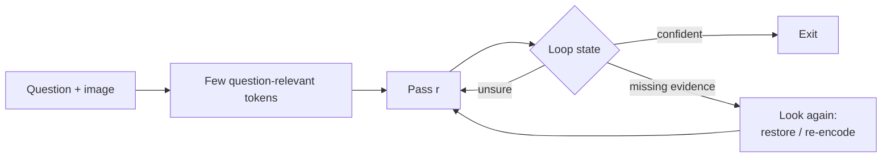

# AdaLoop-VLM — Vision, Discussion and Findings

v1 · Nov 24, 2026 · living document — update after each design session
Read this first in any new session. Details: `docs/01_research/reading_brief.md` (paper cards with page anchors), `docs/02_loop/adaloop_build_spec.md` (how), `docs/02_loop/adaloop_execution_plan.md` + `docs/02_loop/sprint_plan_nov30.md` (when, who).

---

## 1. The vision in five lines

1. A VLM spends the same compute on every question: all visual tokens, a fixed number of loop passes.
2. In a **looped** decoder, which visual tokens matter **changes from pass to pass** (LoopZip, Fig. 2a), so deciding the token set once, up front, is wrong by construction.
3. We let the decoder's own loop state decide, after each pass, to **exit**, **loop again** (think more), or **look again** (restore dropped tokens / re-encode a region).
4. We start each question with few, question-relevant tokens (CRISP-style) and let the loop ask for more only when needed.
5. Backbone: `TML-d24-varloop-research` (Inkling-2 family, loops 1–5). Frozen first; light post-training later.

**Research question:** *Can a looped VLM use its own loop state to decide when to stop thinking and when to look more — and does that beat fixed budgets, learned token counts, early exit alone, and LoopZip at the same measured cost?*

---

## 2. Hypotheses

| ID | Hypothesis | How tested | Status |
|---|---|---|---|
| H1 | Per-item allocation has headroom over the best fixed (k, R) at matched cost, **beyond noise** | 15-cell grid; oracle per cost cap minus noise-ceiling oracle | to test (A7) |
| H2 | Extra loops help only when the evidence survived pruning (loops can re-read, not add pixels) | evidence-retention label from annotated answer regions × Δacc from loops | to test (A7) |
| H3 | A per-pass controller (exit / loop / look) beats fixed, upfront-15-way, tokens-only, early-exit-only, LoopZip-lite | Phase B, matched measured cost | to test (B7) |
| H4 | Attack success changes with tokens, loops and early exit, conditional on clean capability | GUI injection + typographic jailbreak on the grid and policy | to test (B7) |
| H-noise | Question-relevant pruning *raises* accuracy over full tokens on clutter/hallucination-prone items, and lowers it on detail-heavy items | dedicated vision-encoder session (`docs/04_prompts/vision_encoder_session.md`) | to design |

---

## 3. How the idea evolved (decision log)

| Date | Decision | Reason |
|---|---|---|
| Sep–Oct | AdaptiVis: question-conditioned patch count + Matryoshka depth | original framing |
| Nov 22 | Proposal_v2 "Adaptive Looped VLM", Version B: frozen varloop, upfront (k, R) controller, 3×5 grid | backbone with trained elastic depth just released (Nov 20) |
| Nov 24 | Reading brief: controller and generic k×R grid largely taken (StepPrune, SmartVL, TPRL, GRIP-VLM, LoopZip) | literature read |
| Nov 24 | **Reframe:** loop state drives exit / loop / look-again, decided **per pass** | only gap found that the reading supports; uses the looped decoder for something non-looped models cannot do |
| Nov 24 | Text-conditioned pruning is **reused** (CRISP), not the contribution; trained encoder adapter → January, gated | crowded area |
| Nov 24 | "Edge efficient" = the Inkling-family model, not an on-device small model | clarified by Vedaang |
| Nov 24 | Sprint to **Nov 30**; team does inference, Vedaang does training; hardware 4×A40 + A100s (+ H200 if available) | team decision |
| Nov 24 | Upfront 15-way controller becomes a **baseline**; Dec scope adds C1 LoRA (mid-loop insertion) | method change |

---

## 4. What we found

### 4.1 About the backbone (model card, `Papers/.../05- VLM models frontier/2026_TML-d24-varloop-research-model-card.txt`)
- 26.4B MoE, 3.4B active at R=1, +1.0B per extra pass (5.4B at 3, 7.4B at 5). Middle 12 layers looped 1–5. ~20 GB native NVFP4/MXFP8; ≥ 32 GB needed.
- Trained with R sampled 1:2:6:2:1, then **post-trained at R=3**; card warns behaviour at R ≠ 3 may be unpredictable.
- Task-dependent depth: MMMU-Pro 63.6 → 73.2 from R=1 to R=5; PerceptionBench peaks at R=3 (53.9), 52.7 at R=5.
- Safety on the card is **flat across R**: StrongREJECT 98.2–99.4 (98.8 at R=1), FORTRESS-adversarial 89.0–90.4.
- Engineering facts (Nov 24 notebooks): loads in BF16 on 2 A40s (~49 GB); runtime R works, load-time override ignored; thinking not disabled by `reasoning_effort="none"` (100–400 tokens); post-projector pruning exact at k=100%; 512 px → 130 tokens, 4032×3024 → 7,676; HF eager ≈ 0.13 s per decoded token.

### 4.2 About the literature (numbers and pages in `docs/01_research/reading_brief.md`)
- **Learned per-input token count with a frozen decoder exists** (StepPrune). Its adaptive-vs-fixed gain at matched mean K is only −0.57 to +0.90 pp (Fig. 3c).
- **Joint token + compute control exists** (SmartVL), but in a non-recurrent model, with a supplied budget, and its token mask does **not** see the question. Its Fig. 6 grid already shows "no single token/compute configuration is optimal across tasks."
- **Compression inside a looped VLM exists** (LoopZip): training-free, fixed loop schedule, only removes tokens. Token importance shifts across calls.
- **RL for pruning exists** (TPRL PPO, GRIP-VLM GRPO, AdaptVision, VisionThink). RL over its own supervised warm-up adds only 0.1–1.5 pp (GRIP Table 1).
- **Encoder-side loops exist** (LoopLook, AdaLoop): question-conditioned, adaptive depth, but in the vision encoder; perception-heavy tasks take more loops there.
- **Per-item oracles are inflated:** Matryoshka's 5-scale oracle adds ~16 pts on MMMU (Table 2) — mostly noise on multiple choice.
- **Pruning rarely beats full tokens:** a few cases slightly above (GRIP-VLM 100.22% at 192 tokens; TPRL MMBench 101.8%), most at or below. "Pruning removes noise" is unproven.
- **Cost traps:** decode dominates with thinking (SmartVL names decode as open); the ViT can dominate (AdaptMerge: 0.53 s ViT vs 0.17 s LLM); post-projector pruning saves no ViT compute.
- **Safety priors conflict:** fewer loops removes refusal in text LoopLMs (Running Fewer Loops), and per-request depth selection does not fix it; SafeBridge finds attack success can **rise** with depth; query-based token compression **improves** VLM safety (Token-Pruning-Induced Vulnerabilities).
- **No second depth-elastic looped VLM:** LoopVL collapses off its trained schedule (Table 4); SenseNova-Loop-9B runs a fixed 2×; RR-VLM unverified.

### 4.3 Corrections to our own earlier documents
- Proposal_v2 marks SmartVL as text-conditioned (its token mask is not) and misreads its Fig. 6; it omits StepPrune, LoopZip, TPRL, GRIP-VLM, AdaptMerge, LoopLook, AdaLoop, LoopVL.
- The earlier literature review treats LoopVL as a candidate backbone (it is not depth-elastic), misses SenseNova-Loop, and has page anchors off by 1–2 in places.

---

## 5. What we did not find (the gap, with its evidence boundary)

Within 15 P0 + 2 P1 corpus papers, 4 external papers (HTML) and 10 abstract-checked citations:

1. **No method lets the decoder's per-pass loop state decide between exit, more loops, and acquiring more visual evidence.**
2. **No study crosses variable weight-shared loop depth with visual token budget** on one checkpoint (SmartVL crosses tokens with non-recurrent layer skipping).
3. **No study adds visual tokens mid-recurrence** (LoopZip only removes).
4. **No capability-conditioned safety measurement across both token budget and loop depth in a VLM.**

This is not a claim about the whole field. Re-search arXiv weekly for "varloop", "looped VLM", "recurrent depth vision".

---

## 6. Prior work map — what each solves and what it leaves open

### 6.1 Vision side (token selection and adaptive encoding)

| Paper | Problem it solves | How | Leaves open → our use |
|---|---|---|---|
| InstructBLIP [019] | question-blind visual features | instruction-aware Q-Former, frozen ViT + LLM | fixed 32 tokens, decided once → count changes per pass |
| LLaVA-Mini [027] | too many tokens | text pre-fusion, ~1 token | decoder retrained, decided once → frozen decoder, re-expandable |
| Matryoshka M3 [013] | one budget for all | nested token scales | user picks scale; oracle only → loop picks |
| SparseVLM [050] | irrelevant tokens in LLM | text-attention pruning inside LLM | weak in looped VLMs → baseline |
| CRISP [052] | pre-LLM pruning ignores text | noun–token cosine + diversity, pre-LLM | one-shot fixed K → our first-pass selector |
| AdaptMerge [007] | fixed reduction ratio | diversity + text-relevance merging, thresholds | never revisited → loop decides if more needed |
| Hier. Query-Aware Pruning [055] | global vs local budget | thumbnail + crops; image sets K, question allocates | once, pre-LLM → crops as look-again action |
| MVP [056] | heuristic pruners | trained question pruner, frozen VLM | variable K poorly calibrated → loop feedback |
| StepPrune [059] | uniform K | sequential pointer + learned STOP | stops before decoding → stop inside the loop |
| TPRL [061] | hand-crafted scores | PPO policy, query in state | one-shot at inference; LLM tuned → per pass, frozen |
| GRIP-VLM [053] | gradient relaxations | GRPO scorer, budget-aware FiLM | budget supplied → loop chooses budget |
| TOP-RL [060] | static pruning layers | PPO inside decoder layers | remove-only → restore action |
| Glance-ETD [054] | extreme compression loses evidence | glance + evidence scorer + regional re-encode | once, pre-decode → triggered by loop state |
| AdaptVision [051] | always high-res | low-res + RL crop tool | tool calls outside the model → inside recurrence |
| VisionThink | always high-res | low-res, RL requests full image | all-or-nothing, outside model → per pass, per region |
| InternVL3.5 ViR [043] | uniform tile budget | router 256/64 per tile, frozen backbone | image-only, once → question- and loop-conditioned |
| SmartVL | token and compute treated separately | budget-token mask + layer/head gates | mask ignores question; no recurrence → both |

### 6.2 Loop side (recurrent depth and early exit)

| Paper | Problem it solves | How | Leaves open → our use |
|---|---|---|---|
| varloop / Inkling-2 | depth effects confounded across checkpoints | one checkpoint, loops 1–5 | R user-chosen → chosen per input |
| Ouro | reasoning via depth in pretraining | looped LM, learned depth allocation | text only → multimodal + vision action |
| Mixture-of-Recursions | uniform depth per token | per-token routers, recursion-wise KV | pretraining-scale → post-hoc on frozen model |
| LoopFormer | loops collapse at other depths | time/step conditioning, shortcut consistency | no input-adaptive choice → input-adaptive |
| RecursiveVLM [039] | single-pass VLM reasoning | re-run decoder with feedback connector | fixed depth, no tokens → both adaptive |
| RR-VLM* | building looped VLMs is expensive | retrofit TinyLLaVA | little adaptivity → native looped model |
| LoopVL | parameter-efficient VLM | two shared stacks, fixed schedule | not depth-elastic → needs varloop |
| LoopZip [038] | repeated token cost in loops | cross-call selection + value correction, training-free | remove-only, fixed R → restore + exit |
| LoopLook | single-pass encoder perception | loop ViT window, question FiLM, learned exit | encoder loops, decoder fixed → decoder drives encoder |
| AdaLoop | question-blind encoding | loop frozen ViT span with question AdaLN, stability halting | heuristic halt, LM LoRA → learned halt, frozen decoder |
| AdaVSkip* | uniform visual compute per layer | routers skip attention/MLP for visual tokens | non-recurrent → recurrent |
| Running Fewer Loops | safety vs depth unknown | measure refusal vs loops (text) | text only → VLM + early exit |
| SafeBridge | depth-specific jailbreaks | depth-aware alignment (text) | text only → multimodal |

\* abstract-level only.

**Where we sit:** LoopZip (prune between passes) + Glance-ETD/AdaptVision (look again) + LoopLook (adaptive loops), joined by the **decoder's loop state** as the decision signal.

---

## 7. Known risks and open questions

| Risk / question | Where it gets answered |
|---|---|
| Can tokens be added mid-loop without breaking the model? | A3 test 3 → Gate G1 |
| Does early readout after pass r equal running R=r? | A3 test 1 |
| Is there headroom beyond noise? | A7 → Gate G2 |
| Thinking mode: skip or count? | A2 |
| Results are "this checkpoint" (no second elastic looped VLM) | state as scope; re-check January |
| Does pruning ever *improve* reasoning (noise reduction)? | vision-encoder session |
| Does early exit lower refusal in a VLM? | B7 safety |
| Concurrent work on varloop (released Nov 20) | weekly arXiv check |

---

## 8. Session starters

Use `docs/README.md` for copy-paste prompts to start focused sessions on: execution, vision encoder, looping and controller, safety.
