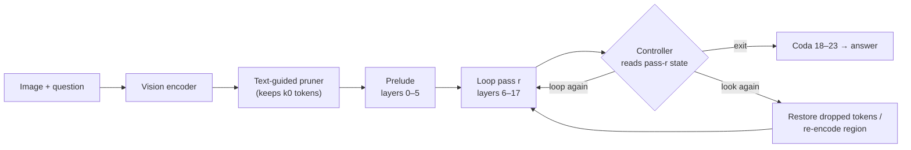
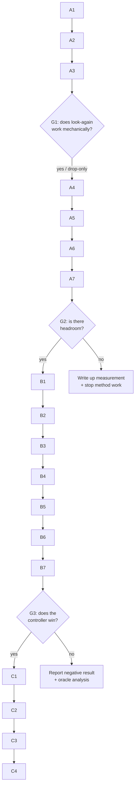

# AdaLoop-VLM — Execution Plan

Nov 24, 2026 · supersedes the 9-step breakdown · companion to `docs/01_research/reading_brief.md`

---

## 0. What we are building (one paragraph)

A looped VLM that decides, **after every loop pass**, whether to **exit** (answer now), **loop again** (think more), or **look again** (bring back visual tokens it dropped, or re-encode a region at higher resolution). It starts each question with few visual tokens chosen by a text-guided pruner. The backbone is `thinkingmachines/TML-d24-varloop-research` (same architecture as Inkling 2 Mini, but the loop count can vary from 1 to 5). The backbone stays frozen in Phases A and B. Only small modules are trained.

**Research question:** can a looped decoder use its own loop state to decide when to stop thinking and when to look more, and does this beat fixed budgets, learned-token-count methods, early exit alone, and LoopZip at the same measured cost?



**What is reused, not claimed** (see reading brief): text-guided pruning (CRISP), learned token count (StepPrune), crops/resolution (AdaptVision, Glance-ETD), early exit (Ouro, LoopLook), pruning inside loops (LoopZip). **The contribution is the loop state driving the exit / loop / look decision.**

---

## 1. How to use this guide

- Three phases. **A** = measure the pretrained model, no training. **B** = build the adaptive system, train only small modules. **C** = post-train the backbone and encoder (January).
- Every step has: **Goal · Do · Check · Output · If it fails.** Do not start a step until the previous step's **Check** passes.
- Three **gates** (G1–G3) decide whether to continue, change scope, or stop.
- Paths use placeholders: `<REPO>`, `<MODEL_DIR>`, `<DATA_DIR>`, `<RESULTS_DIR>`.



---

## Phase A — Baseline and inference (no training)

### A1. Load the model and confirm loop control
- **Goal:** a working, inspectable model where R really changes the computation.
- **Do:**
  1. Load in BF16 across 2 GPUs (`device_map="auto"`). Already working (~49 GB).
  2. Set R **at runtime** (the load-time `text_config={"loop_num_passes": R}` override is ignored).
  3. Register forward hooks on layers 0–23 and count calls per forward pass.
  4. Expose: projector output (visual tokens), hidden state after prelude, after each loop pass, and after coda.
- **Check:** call counts are `6 + 12·R + 6` per forward for R = 1..5. Outputs differ across R. k = 100% reproduces the unmodified model exactly (already true).
- **Output:** `<REPO>/adaloop/load.py`, `<REPO>/adaloop/hooks.py`, `<REPO>/tests/test_loop_control.py`.
- **If it fails:** read the `inkling2_loop` modeling code for where `num_passes` is read; patch that field directly.

### A2. Decide how to handle thinking
- **Goal:** a fixed, honest rule for the 100–400 thinking tokens the model writes before answering.
- **Do:**
  1. Inspect the chat template for a way to close or skip the thinking block (e.g. pre-fill the end-of-thinking marker in the assistant turn). `reasoning_effort="none"` does **not** disable it.
  2. If thinking can be skipped: run short-answer mode for all of Phase A, and say so.
  3. If it cannot: keep it, cap it (`max_new_tokens = <T_MAX>`), and log thinking length as a **third cost axis**.
- **Check:** on 20 GQA items, the chosen mode gives a parseable answer ≥ 95% of the time.
- **Output:** `<REPO>/adaloop/prompting.py` + a one-paragraph decision note in `<RESULTS_DIR>/decisions.md`.
- **If it fails:** keep thinking on; cost = prefill + decode, measured.

### A3. Feasibility tests for the new design ⚠️ most important step
- **Goal:** find out if the backbone tolerates the operations our method needs. **No training.**
- **Do** (50 GQA + 50 TextVQA items, R_max = 5):
  1. **Early-readout equivalence.** Run R = 5, read out (coda + LM head) after pass r. Compare to a fresh run at R = r. Metric: KL of last-token logits, answer agreement.
  2. **Drop mid-loop.** Start with 100% tokens, drop to 50% after pass 2 (CRISP scores). Compare to pruning before the prelude at the same average token count.
  3. **Add mid-loop.** Start with 25% tokens, restore the dropped tokens after pass 2. Two ways to insert them:
     - (a) **Insert:** run the restored tokens through the prelude, insert their prelude output at pass 3 (no history from passes 1–2).
     - (b) **Restart:** re-run the loop from pass 1 with the full set (always valid, costs more).
     Compare (a) and (b) with a 100%-token run.
- **Check (pass criteria, set before running):**
  - Test 1: answer agreement ≥ `<τ_eq>` (suggest 90%). If yes, one R = 5 run gives all five R values cheaply.
  - Test 3a: accuracy within `<δ>` points of the 100% run (suggest 3).
- **Output:** `<REPO>/notebooks/03_feasibility.ipynb`, `<RESULTS_DIR>/feasibility.md`.
- **If it fails:**
  - Test 1 fails → pay full cost for each R in the grid.
  - Test 3a fails, 3b passes → look-again = restart (more costly; still a valid action, cost counted).
  - Both 3a and 3b fail → look-again is dead; scope shrinks to **exit + drop-only** (closer to LoopZip; weaker paper).

### 🚦 Gate G1 — Does look-again work mechanically?
Write one paragraph in `decisions.md`: which of insert / restart / drop-only we use, and why.

### A4. Evaluation pipeline
- **Goal:** one command that runs any (benchmark, k, R, policy) and logs everything.
- **Do:**
  1. Loaders: GQA (testdev-balanced), TextVQA (val), ChartQA (test), MMMU (val). Fixed item IDs. **Dev split = 200 items per benchmark, never used for test.**
  2. Official scorers (exact match, VQA accuracy, relaxed accuracy, MC accuracy).
  3. Per item, log: prediction, correct, #visual tokens, #text tokens, R, thinking tokens, ViT time, prefill time, decode time, peak memory, analytic FLOPs (ViT + prefill + decode).
  4. Greedy decoding; prompts frozen before any test run.
  5. Re-run 50 items twice → nondeterminism rate.
- **Check:** full-model R = 3 accuracy is plausible against public numbers where comparable; nondeterminism rate recorded.
- **Output:** `<REPO>/adaloop/data/`, `<REPO>/adaloop/eval/runner.py`, `<REPO>/adaloop/eval/cost.py`, one row per run in `<RESULTS_DIR>/runs.parquet`.

### A5. Loop sweep (first milestone)
- **Goal:** how accuracy and cost move with R alone.
- **Do:** 200 GQA items × R = 1..5 at k = 100%. Then repeat on 200 items each of TextVQA, ChartQA, MMMU.
- **Check:** R changes accuracy on at least one benchmark; cost grows roughly linearly with R (prefill) — check how much of total cost is decode.
- **Output:** **Milestone table** — accuracy, latency (TTFT, total), FLOPs, thinking length, for R = 1..5.
- **Time budget:** at ~0.13 s per decoded token and 100–400 thinking tokens, one item ≈ 13–52 s. 1,000 GQA runs ≈ 4–14 h on one replica → spread over `<N_REPLICAS>` replicas.

### A6. Visual token reduction
- **Goal:** a token-budget module and the right selector.
- **Do:** at R = 3, compare four selectors at k ∈ {25, 50, 100}%:
  1. random (control); 2. uniform pooling (text-agnostic); 3. **CRISP-style** text-guided (cosine of projected visual tokens with LLM input embeddings of question nouns + diversity fill); 4. resolution reduction (ViT emits ≈ k·N tokens).
  - **Keep pruned tokens at their original positions** (do not pack them contiguously — the decoder uses relative-position bias and short causal convolutions).
  - Fix the image-resolution policy now (e.g. long side `<RES_PX>`), and log ViT time separately.
- **Check:** k = 100% reproduces baseline exactly; text-guided beats random at 25%. Choose one selector **on the dev split only** and freeze it.
- **Output:** `<REPO>/adaloop/budget.py`, selector comparison table.

### A7. Joint grid and analysis
- **Goal:** the 15-cell (k × R) baseline and the answer to "is there headroom?"
- **Do:**
  1. Run all 15 cells on the test items (1,000 per benchmark if throughput allows; else 500, and say so).
  2. **Oracle per cost cap:** for each mean-cost cap, the best per-item assignment vs the best single fixed cell.
  3. **Noise ceiling:** re-run a subset; estimate how much oracle headroom comes from random flips alone.
  4. **Evidence-retention label** (for TextVQA / ChartQA / ScreenSpot, where answer regions are annotated): did the pruner keep the answer region? Test: do extra loops help only when evidence was kept?
- **Check:** oracle headroom minus noise ceiling ≥ `<Y>` points (suggest 3) on at least one benchmark.
- **Output:** iso-cost plot, accuracy surface per benchmark, headroom table, evidence-retention analysis.

### 🚦 Gate G2 — Is adaptive allocation worth building?
- **Yes** → Phase B.
- **No** → write up Phase A as a measurement report (grid + evidence-retention result). Stop method work.

---

## Phase B — Build the adaptive system (backbone frozen, small modules trained)

### B1. Per-pass state readout
- **Goal:** cheap features the controller can see after each pass.
- **Do:** after pass r, extract: (i) last-token hidden state (pooled), (ii) change from pass r−1 (norm of difference), (iii) early-readout entropy and KL vs previous pass (needs coda — cost counted), (iv) attention mass on visual tokens and on pruned-region neighbours.
- **Check:** feature extraction adds < `<X>`% to per-pass time.
- **Output:** `<REPO>/adaloop/controller/features.py`.

### B2. The three actions
- **Goal:** exit, loop again, look again as callable operations.
- **Do:**
  - **Exit:** run coda + decode from the current state.
  - **Loop again:** run one more pass.
  - **Look again:** the method chosen at G1. Two variants:
    - *Restore:* bring back the top-m dropped tokens near the most-attended region (cheap; ViT already ran).
    - *Re-encode:* crop the most-attended region, run the ViT at higher resolution, insert new tokens (costly; recovers detail).
- **Check:** each action reproduces the corresponding fixed setting when forced (e.g. "never exit before 3" = R = 3).
- **Output:** `<REPO>/adaloop/actions.py`, unit tests.

### B3. Heuristic controller (no training)
- **Goal:** a strong, simple baseline before any learning.
- **Do:** exit when KL(pass r ‖ pass r−1) < `<ε>`; look again when entropy stays high and visual-attention mass is high; else loop. Tune thresholds on dev only.
- **Check:** traces a Pareto curve as thresholds vary.
- **Output:** `<REPO>/adaloop/controller/heuristic.py`.

### B4. Collect per-pass trajectories
- **Goal:** training data for a learned controller.
- **Do:** for each training item, run the action tree up to depth `<D_MAX>` (exit / loop / look at each pass) and record correctness and cost at every leaf. Prune the tree with the G1 result (e.g. at most one look-again).
- **Check:** every leaf has a reward; storage fits.
- **Output:** `<RESULTS_DIR>/trajectories.parquet`.

### B5. Learned controller
- **Goal:** a small policy over {exit, loop, look} at each pass.
- **Do:**
  1. **Supervised:** label = cheapest correct path; cross-entropy. Baseline.
  2. **Full-information cost-sensitive:** all leaf rewards are known → maximise expected reward `correct − λ·cost/cost_max` exactly. **This is not RL**; do not call it GRPO.
  3. **On-policy RL (GRPO / PPO):** only when outcomes for unchosen actions are unknown (long generations, sampling). January.
  - Model: 2-layer MLP, 512 hidden. Sweep λ.
- **Check:** at λ → 0 it matches best accuracy; at large λ it exits at pass 1.
- **Output:** `<REPO>/adaloop/controller/policy.py`, `<REPO>/scripts/train_controller.py`.

### B6. Baselines
| Family | Baseline |
|---|---|
| Fixed | best single (k, R) at each cost level |
| Upfront joint | 15-way MLP choosing (k, R) before the decoder runs (the old Version B) |
| Tokens only | learned per-input k at fixed R (StepPrune-style, frozen decoder) |
| Loops only | early exit only (KL threshold), full tokens |
| Looped compression | **LoopZip** (training-free, cross-pass pruning) |
| Heuristic | B3 |
| Upper bound | per-item oracle with noise ceiling |

### B7. Evaluation and safety
- **Goal:** the headline result.
- **Do:**
  1. Held-out items, matched **measured** cost (latency on A40 and analytic FLOPs). Paired bootstrap CIs.
  2. Action statistics per benchmark (how often exit / loop / look).
  3. **Safety (if time):** clean vs adversarial pairs (GUI injection on ScreenSpot, typographic jailbreaks). Report attack success **conditional on clean correctness**. Check whether early exit raises attack success.
- **Check:** controller beats every baseline in B6 at matched cost on ≥ 2 benchmarks, CIs excluding zero.
- **Output:** headline table + Pareto plots.

### 🚦 Gate G3 — Does the controller win?
- **Yes** → Phase C.
- **No** → report negative result with oracle and evidence-retention analysis.

---

## Phase C — Post-training (January)

### C1. Make the backbone tolerate mid-loop insertion
- **Goal:** if look-again used "restart" or degraded at G1, teach the model to accept new tokens mid-loop.
- **Do:** LoRA (r = 16) on attention of looped layers 6–17; train with random insertion points; distil from the full-token model's logits.
- **Check:** insert-mode accuracy within `<δ>` of restart-mode, at lower cost.

### C2. Text-conditioned vision encoder
- **Goal:** prune inside the ViT, saving ViT compute.
- **Do:** fuse a pooled question embedding into ViT layer ℓ (FiLM / AdaLN, as LoopLook / AdaLoop); a token scorer drops tokens after ℓ; train adapter + scorer (+ LoRA on ViT layers ≥ ℓ) by distillation from the full model.
- **Check:** beats post-projector pruning at equal tokens **and** reduces measured ViT time.

### C3. Joint training
- **Goal:** train controller + LoRA together.
- **Do:** GRPO with G = 4–8 rollouts per prompt, short-answer tasks, KL to the frozen model.
- **Check:** beats the frozen-backbone controller (B5) at matched cost.

### C4. Safety training (only if B7 shows a problem)
- **Do:** depth-randomised safety LoRA, or a safety term in the controller reward.
- **Check:** attack success at reachable actions ≤ default (k = 100%, R = 3), over-refusal unchanged.

---

## 2. Timeline

> **Superseded (Nov 24):** the team compressed this to a sprint ending Nov 30 — see `docs/02_loop/sprint_plan_nov30.md`. The table below is the original pacing, kept for reference.

| Window | Scope |
|---|---|
| Nov 25–26 | A1, A2, **A3** → G1 |
| Nov 27–29 | A4, A5 (milestone), A6 |
| Nov 30–Dec 1 | A7 → G2; B1–B3 (heuristic controller) |
| **Dec 3 (course)** | Phase A complete + G1 result + heuristic controller vs fixed / early-exit / LoopZip |
| January | B4–B7, Phase C |

---

## 3. Repository layout

```
<REPO>/
  adaloop/
    load.py            # A1
    hooks.py           # A1, B1
    prompting.py       # A2
    budget.py          # A6 selectors
    actions.py         # B2
    controller/{features,heuristic,policy}.py
    data/              # A4 loaders
    eval/{runner,cost}.py
  notebooks/03_feasibility.ipynb   # A3 (inspection only)
  scripts/{run_grid,train_controller}.py
  tests/
  configs/
<RESULTS_DIR>/{runs.parquet, trajectories.parquet, decisions.md, feasibility.md}
```

---

## 4. Open items to fix before A4

- GPU count: plan says `<N_GPUS>` — the 9-step note says 6, the proposal says 8.
- Resolution policy: 512 px → 130 tokens; full 4032×3024 → 7,676 tokens. Pick `<RES_PX>`.
- Throughput: HF eager ≈ 0.13 s per decoded token. Check whether SGLang / vLLM expose per-request loop count; if so, use them for the grid.
- Pre-register Y, δ, τ_eq and the controller's target gap before running A7.
