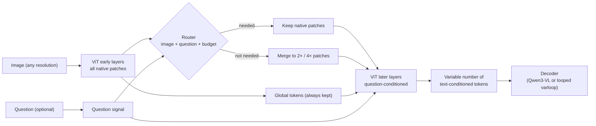
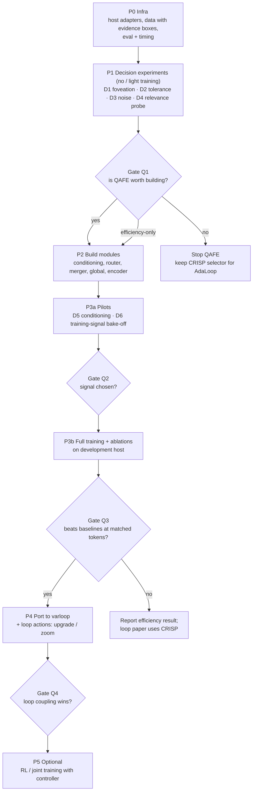

# QAFE — Question-Adaptive Foveated Encoder · High-Level Spec

v2 · Nov 24, 2026 · owner: Vedaang · working name, rename freely
**Read this first.** It covers the idea, the evidence, what is already done in the literature and what is not, the decisions still open, and the phases. Build details are in `docs/03_encoder/qafe_build_spec.md`.
Related: `docs/02_loop/adaloop_execution_plan.md` (AdaLoop phases A–C), `docs/02_loop/adaloop_build_spec.md` (AdaLoop build), `docs/01_research/reading_brief.md` (paper cards).

---

## 1. The idea in one paragraph

A vision encoder that reads **the image and the question** and gives the decoder **fewer, smarter tokens**. Regions the question needs stay at native patch size. Regions it does not need are **merged into bigger patches** inside the ViT, which also saves ViT compute. A few **global tokens** always summarise the whole image. Every output token is **text-conditioned**. The number of output tokens depends on the image, the question and a budget. The encoder is built as an **adapter on a host VLM's own ViT**, so it can plug into a normal VLM (Qwen3-VL) and into our looped VLM (varloop). In the looped VLM, the loop can later ask the encoder to **upgrade coarse regions to fine** or **zoom into a crop**.

**Physical limit:** the encoder cannot create detail finer than the input pixels. "Smaller patch" means *keep native size*; "bigger patch" means *merge*. Finer-than-input detail needs a **high-resolution crop**, which is a loop action, not an encoder feature.

---

## 2. Why this, and what the evidence says

### 2.1 How frontier VLMs encode images today

| Model | Encoding | Question-aware? | Token count set by |
|---|---|---|---|
| Kimi K3 (MoonViT-V2) | Native resolution up to 3584², trained from scratch with next-token prediction, fixed 2×2 pixel shuffle (p.9–10) | No | Image size |
| Inkling 2 / varloop | Native-resolution ViT, 2D rotary, CLS token, 2×2 merge; 23L, 1024d, 20 px (NeMo code docs, model card) | No | Image size |
| Qwen2.5-VL / Qwen3-VL | Native resolution, 2×2 MLP merger; Qwen2.5 uses window attention; Qwen3 adds DeepStack | No | Image size |
| InternVL3.5 | 448² tiles, pixel shuffle; Flash adds per-tile router (256 vs 64 tokens) | No (image content only) | Size + content |
| Molmo / Molmo2 | Low-res global + overlapping high-res crops, 2×2 attention pooling | No | Size |
| LLaVA-UHD v4, NVILA | Slices / multi-scale tiles, compression inside or after the ViT | No | Size |

**Gap:** no frontier encoder uses the question while encoding. All adaptivity is from image size or image content.

### 2.2 What question-conditioned pruning and selection achieve

- **Efficiency works:** 10–30% of tokens keeps ~95–99% of accuracy (CRISP, HQAP, GRIP, TPRL, StepPrune).
- **Adaptive count per question adds little:** ≤ 0.9 pp (StepPrune Fig. 3c), +0.2 pp (HQAP Table I), sometimes negative (MVP App. Table 6).
- **Question inside the ViT helps at the same token count:** +0.8–5 pts (QA-ViT Table 1).
- **Detail-heavy tasks break:** OCRBench 590 vs 848 at 5% tokens (Glance-ETD); DocVQA 66.8 vs 95.1 with SparseVLM at 50% (AdaptVision Table 1); training-free encoder pruning collapses grounding (Rescuing Table 1).

### 2.3 Does "cleaner tokens → better answers" hold?

- **Beating full tokens is rare and small:** mostly POPE, ≤ 2 pts.
- **The POPE gain is probably not relevance.** A question-agnostic pruner (DivPrune) gets the same gain (GRIP Table 1). The likely cause is an answer-bias shift: less evidence → more "no".
- **On safety, relevance-only keeping is harmful:** it concentrates attention and raises jailbreak success (Token-Pruning Vulnerabilities).
- **Why accuracy usually doesn't rise:**
  1. The decoder's attention already selects what is relevant.
  2. A selector miss costs the whole item, while extra tokens cost little.
  3. The question often can't tell you where to look ("what's unusual?", counting).
  4. Decoders are trained on full token sets, so pruned inputs are out of distribution.

**Consequence for our claims:**

| Claim | Strength |
|---|---|
| **Main:** at a matched token budget, QAFE beats uniform downscaling and image-only compression; the gap grows as the answer region shrinks | Plausible, untested — first experiment |
| **Secondary:** at ≤ 25–35% of tokens, QAFE matches full tokens and cuts ViT + prefill time | Likely, given prior work |
| **Loop coupling:** loop-driven refinement beats encoder-only QAFE at matched cost | Open — the novel core |
| **Stretch:** beats full tokens on clutter / hallucination strata | Weak prior — test with controls, don't assume |

---

## 3. What is done, partly done, and not done

| Component | Status | Closest work (what they did) |
|---|---|---|
| Global thumbnail + local crops | **Done** | Molmo, LLaVA-UHD, InternVL, NVILA |
| Question injected into the ViT | **Done** | QA-ViT (top-L layers, token count unchanged); LoopLook / AdaLoop (zero-init FiLM / AdaLN, looped ViT) |
| Question-driven budget over thumbnail + crops + tokens | **Done (training-free)** | HQAP |
| Low-res glance → re-encode relevant regions | **Done (MLLM trained)** | Glance-ETD |
| Crop requested by the model | **Done (RL, generated token)** | AdaptVision, VisionThink |
| Merge tokens inside the ViT to save encoder cost | **Done (image-only)** | LLaVA-UHD v4, DynamicViT, ToMe, SmartVL (image + budget) |
| Variable token count per input | **Done** | StepPrune, TPRL, InternVL3.5 ViR |
| Variable patch size (quadtree-style) | **Exists image-only — not verified this session** | Adaptive-patch / quadtree ViTs |
| **Question-conditioned, in-ViT variable patch size, frozen decoder, plug-in** | **Partly open** | Nearest: Glance-ETD (trains MLLM), QA-ViT (no reduction), UHD v4 (no question) |
| **Matched-budget test vs uniform downscaling, stratified by evidence size** | **Open as a clean study** | — |
| **Decoder-loop state decides when/where to refine (coarse → fine, crop)** | **Open** | Nearest: LoopZip (drop-only, fixed schedule), AdaptVision / VisionThink (generated tool call), LoopLook (loops the encoder) |

**Positioning.** QAFE alone is mostly a combination, with a partly open slot (frozen-decoder, question-conditioned, in-ViT variable patching) and a clean matched-budget study. The **loop coupling** is the publishable core. QAFE is the module that makes it possible and gives the paper a strong ablation section.

### 3.1 How prior work trained their modules (facts, not our choice)

| Paper | Signal |
|---|---|
| QA-ViT | CE on answers; LoRA on LLM + question MLPs |
| Glance-ETD | Single-rollout self-distillation; MLLM trained |
| InternVL3.5 ViR | Consistency KL (compressed vs full), then router CE on loss-ratio labels; backbone frozen in router stage |
| SmartVL | Supervised + FLOPs penalty; Gumbel-sigmoid mask |
| GRIP-VLM | SFT warm-up → GRPO; LLM frozen; RL over SFT +0.1–0.4 pp encoder-side |
| StepPrune | CE + expected-length penalty, noise-gated surrogate |
| AdaptVision / VisionThink | RL (VisionThink: LLM-as-judge reward + call-ratio penalty) |
| LoopLook / AdaLoop | Next-token loss + depth penalty / deep supervision; zero-init conditioning |
| DynamicViT | Gumbel + distillation + keep-ratio loss |

**We do not pre-select the training signal.** Phase P1 decides it by experiment (§5).

---

## 4. Hypotheses (falsifiable)

| ID | Hypothesis | Killed if |
|---|---|---|
| **H-F** (foveation) | Thumbnail + oracle crop beats uniform downscaling at the same token count on small-target items | Oracle crop gain < `<Y_F>` pts on the small-target stratum |
| **H-T** (tolerance) | A frozen decoder accepts merged (coarse) tokens with little loss | Coarse-merge emulation loses > `<δ>` pts vs dropping at the same count |
| **H-R** (relevance is learnable early) | ViT features at some layer ℓ ≤ ⅔ depth, plus the question, predict the evidence region | Probe AUROC < `<AUC_MIN>` at every layer ≤ ⅔ depth |
| **H-C** (conditioning helps) | Zero-init question conditioning improves accuracy at fixed tokens with a frozen decoder | No gain over the no-conditioning adapter at matched training |
| **H-N** (noise) | Question-relevant selection beats full tokens on clutter / hallucination strata after controls (random-k, mean-token replacement, yes-ratio) | Gain vanishes under controls |
| **H-L** (loop) | Loop-driven upgrade / zoom beats encoder-only QAFE at matched measured cost | No gain at matched cost |

---

## 5. Open design decisions and the experiment that decides each

| Decision | Options | Decided by |
|---|---|---|
| Is the main claim viable at all? | go / efficiency-only / stop | **D1** foveation oracle |
| Coarse token format | merged (pooled) vs dropped | **D2** tolerance test |
| Where global tokens go | separate thumbnail segment vs pooled in-grid vs none | **D2** |
| "Better than full" claim | keep / drop | **D3** noise controls |
| Router layer ℓ; single-stage vs two-stage (glance → re-encode) | ℓ ∈ {4, 8, 12, 16}; fallback to two-stage | **D4** relevance probe |
| Keep question conditioning? Mechanism? | AdaLN vs QA-ViT concat vs none | **D5** conditioning pilot |
| **Training signal** | distillation · SFT on answers · router labels (loss-ratio or oracle boxes) · RL (GRPO, rule-based reward) · mixes | **D6** training-signal bake-off |
| Host for development | Qwen3-VL vs varloop | Engineering check in P0 (DeepStack, positions) |
| Adaptive count vs fixed budget | router chooses n vs budget given | Ablation in P3 |

### 5.1 How we decide distillation vs reward (D6 logic)

Run each objective on the **same small setup** (same host, same ~20K samples, same steps, same trainable params), then evaluate at **matched token budgets** on dev.

| Objective | What it optimises | Upper bound | When it is the right choice |
|---|---|---|---|
| **Distillation** (KL to the full-token teacher) | Copy the full model's answer distribution with fewer tokens | **The teacher** — cannot exceed it | Goal is parity at low cost (main + secondary claims) |
| **SFT** (CE on ground-truth answers) | Correct answers | Can exceed the teacher; noisier | Teacher is often wrong on the target strata |
| **Router supervision** (loss-ratio labels / oracle boxes) | Router picks the right regions | The label quality | Router is the weak link (low recall of evidence) |
| **RL** (GRPO, reward = correct − λ·tokens) | Final correctness under a budget | Can exceed the teacher | Above-teacher headroom exists **and** the reward signal isn't starved |

**Diagnostics logged for every objective:**
- Dev accuracy at b ∈ {0.2, 0.35, 0.5}, plus the sample-efficiency curve.
- Budget calibration |n/N − b|.
- Evidence recall: fraction of evidence units kept fine.
- Teacher-agreement rate; accuracy on teacher-wrong items.
- RL only: fraction of GRPO groups with zero advantage (all-correct or all-wrong) and reward variance.

**Decision rule (pre-registered):**
1. If D3 finds **no** above-full headroom → the target is the teacher. Pick the best dev objective at matched tokens; if tied within CI, take the cheapest (usually distillation).
2. If D3 **does** find headroom on some strata → add an outcome term (CE or RL). Keep RL only if it beats the best non-RL objective by ≥ `<RL_MARGIN>` pts **and** its zero-advantage fraction is < `<ZA_MAX>`.
3. If evidence recall is the bottleneck (low recall, high accuracy loss) → add router supervision whatever the objective.

---

## 6. Phases

| Phase | Goal | Output | Gate |
|---|---|---|---|
| **P0** Infra | Host adapters (varloop, Qwen3-VL) with identity tests; datasets with evidence boxes and strata; eval + A40 timing | Working harness | Identity tests pass |
| **P1** Decision experiments | D1–D4, mostly no training | `decisions.md` entries | **Q1:** D1 passes → full QAFE; D1 fails but D2 passes → efficiency-only QAFE; both fail → stop |
| **P2** Build | All QAFE modules; adapter off ⇒ host exactly | `qafe/` package | Unit + identity tests |
| **P3a** Pilots | D5 conditioning; D6 objective bake-off | Chosen conditioning + training signal | **Q2:** decision rule §5.1 |
| **P3b** Train + ablate | Full training on the development host; ablations A1–A10 | Main + ablation tables | **Q3:** beats uniform downscaling **and** the CRISP-style selector at matched tokens on ≥ 2 small-target benchmarks, CI excludes 0; grounding doesn't collapse |
| **P4** Loop integration | QAFE on varloop; LOOK actions = upgrade / zoom; plug into AdaLoop controller | Loop-coupled results | **Q4:** beats encoder-only QAFE and AdaLoop B6 baselines at matched measured cost |
| **P5** Optional | RL / joint controller + encoder | — | Only if P4 positive |

### 6.1 How this plugs into the AdaLoop proposal

| AdaLoop step (`execution_plan.md`) | QAFE role |
|---|---|
| A6 selector | QAFE emulation (D2) and CRISP are both candidate first-pass selectors |
| A3 test 3 (insert / restart) | Decides whether upgrade / zoom tokens can be inserted mid-loop |
| B2 LOOK action | Implemented as **upgrade** (coarse → fine, reusing cached early-ViT features) or **zoom** (crop at higher resolution) |
| B1 features | Add "attention mass on coarse tokens" as a LOOK signal |
| C2 text-conditioned encoder | **Replaced by this spec** |
| C3 joint GRPO | P5 |

### 6.2 Timeline (indicative)

| Window | Phase |
|---|---|
| Nov 25–30 | P0 + P1 (D1–D3 on the inference pipeline; D4 probe is cheap) |
| Dec 1–14 | P2 build; P3a pilots at small scale |
| Jan wk 1–2 | P3b full training + ablations (development host) |
| Jan wk 2–4 | P4 varloop port + loop coupling |

---

## 7. Evaluation (summary)

- **Strata:**
  - Small target / high-res: V*, HR-Bench, TextVQA, OCRBench, DocVQA, ChartQA
  - General: GQA, MMBench, MMStar
  - Hallucination: POPE with yes-ratio + F1, HallusionBench
  - Reasoning: MMMU, MathVista
  - Grounding guardrail: RefCOCO
- Every result is also split by **evidence-area ratio** where boxes exist.
- **Baselines at matched tokens:** full · uniform downscale · fixed pooling · ToMe (in-ViT, image-only) · uniform in-ViT merge (UHD-v4-lite) · CRISP-style · HQAP-style · DivPrune · Glance-ETD (if code available) · oracle-box upper bound.
- **Cost:** tokens, ViT ms, prefill ms, TTFT on A40.
- **Statistics:** paired bootstrap, ≥ 500 items per benchmark, pre-registered thresholds.

---

## 8. Risks

| Risk | Signal | Response |
|---|---|---|
| Oracle foveation doesn't beat uniform downscaling | D1 | Efficiency-only QAFE; loop-first paper |
| Frozen decoder rejects merged tokens | D2 | LoRA on projector / first decoder layers |
| Relevance not predictable early in the ViT | D4 | Two-stage design: glance → re-encode (closer to Glance-ETD) |
| Distillation caps us at the teacher | D3 + D6 | Outcome term (CE / RL) on strata with headroom |
| RL signal starved | D6 zero-advantage fraction | Drop RL |
| Qwen3-VL DeepStack complicates merging | P0 | Develop on varloop only |
| A competing paper releases a frozen-decoder version | Lit watch | Lean on loop coupling |

---

## 9. Not verified

- **Web extractions only:** QA-ViT, VisionThink (abstract), Token-Pruning Vulnerabilities (HTML).
- **Inkling ViT:** NVIDIA NeMo code docs, not a paper.
- **Qwen3-VL:** "no window attention" inferred from the report, not the code.
- **Adaptive-patch-size ViT literature:** not read this session.
- **LoopLook / AdaLoop:** existing notes, not PDFs.
