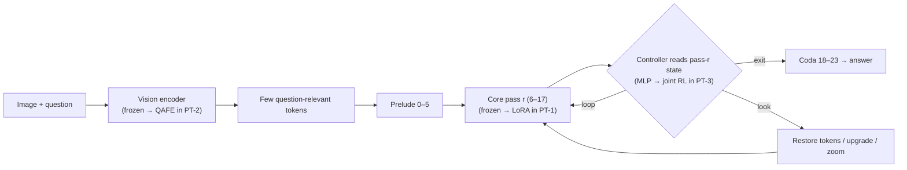
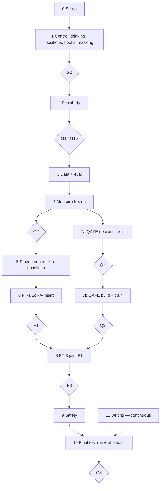

# AdaLoop-VLM — Implementation Guide (master reference)

v1 · Nov 24, 2026 · owner: Vedaang · **this file wins on any conflict with other docs**
Path: `docs/IMPLEMENTATION.md`. Background and detail: `docs/README.md` (index of all docs).

---

## 0. How to use this file

**For Vedaang:** work top to bottom. Each step has a checkbox. A step is done only when its **Done when** line is true and the result is written to `docs/decisions.md` (for gates) or `execution_results/` (for runs).

**For the coding agent:**
1. Read this file fully, then `AGENTS.md`, then `docs/ai_context/CODEBASE_MAP.md`.
2. Work on **one step at a time**, in order. Do not start a step whose **Depends on** is not done.
3. Before writing code for a step, write a **layer plan** (§4.2) and wait for approval.
4. Lines marked **CORE (Vedaang)** are left as `TODO(vedaang)` with a docstring, signature, and a test. Do not implement them unless asked.
5. After each step: run its tests, update `CODEBASE_MAP.md`, tick the box, commit with prefix `agent:` (ask before every push).
6. Never run on the `test` split until Step 10.1.

**Legend:** `[ ]` todo · `[x]` done · `[~]` skipped by a gate (write why in `decisions.md`).
**Owners:** **A** = agent writes it · **V** = Vedaang writes the core logic · **A+V** = agent scaffolds, Vedaang fills the core.
**People:** who owns each step (Vedaang / teammate A / teammate B) is in `docs/TEAM_PLAN.md` §3. Each person's agent works only on that person's steps.

---

## 1. The project in one page

**Research question.** Can a looped VLM use its own loop state to decide, after each pass, to **exit**, **loop again**, or **look again** (get more visual evidence)? And does post-training the model and its vision encoder for this make it beat fixed budgets, learned token counts, early exit alone, and LoopZip at the same measured cost?

**Backbone.** `thinkingmachines/TML-d24-varloop-research`: 26.4B MoE, 24 layers. Prelude = layers 0–5 (run once). Core = layers 6–17 (run R ∈ {1..5} times). Coda = layers 18–23. Vision tower: 23 layers, 20 px patches, 2×2 merge → 2304-d tokens.



**Contributions (what the paper claims).**
1. A measurement of how visual tokens (k) and loop depth (R) trade off on one weight-shared looped VLM, with an oracle, a noise ceiling and an evidence-retention analysis.
2. A per-pass controller over {exit, loop, look}, first on the frozen model.
3. **Post-training** that makes the model loop-aware:
   - **PT-1:** LoRA so the model accepts tokens added mid-loop.
   - **PT-2:** a question-aware encoder (QAFE) that supplies the first tokens and the look-again tokens.
   - **PT-3:** joint RL of controller + LoRA (+ encoder router) with a cost penalty.
4. Capability-conditioned safety across tokens, loops and early exit.

**What each post-training stage fixes** (the reason it is in the paper):

| Stage | Frozen-model problem | Fix | Proven by |
|---|---|---|---|
| PT-1 | Tokens inserted mid-loop have no history; accuracy drops or we must restart | Distillation LoRA on core layers | Insert+LoRA ≈ restart accuracy at lower cost |
| PT-2 | Encoder ignores the question; pruning after the projector saves no ViT time | QAFE adapter | Beats CRISP / uniform at same tokens; ViT time falls |
| PT-3 | Controller and model are trained apart | Joint GRPO | Beats frozen controller + PT-1 at matched cost |

**Reused, not claimed:** CRISP-style selection, StepPrune-style learned count, LoopZip compression, crops (AdaptVision, Glance-ETD), early exit (LoopLook).

---

## 2. Facts already established (from notebooks 01 and 02)

| Fact | Evidence | Consequence |
|---|---|---|
| Loads with `AutoModelForMultimodalLM` + `AutoProcessor`, BF16, no missing keys, ~49 GiB on 2 A40s | nb01 cells 11, 14 | **No Inkling code to write.** Use the HF modeling code. |
| `text_config={"loop_num_passes": R}` at load is ignored; runtime `set_loops(R)` on `model.config.text_config` and `language_model.config` works | nb01 cells 11, 29 | R is a runtime knob |
| Text model class `Inkling2LoopTextModel`; extra modules `message_input`, `final_input` | nb01 cell 28, device map | Passes exchange a gated message, and coda input is mixed. Early readout must copy this (Step 1.5). |
| Attention forward takes `relative_distance`, `conv_mask`, `attention_mask` | nb02 cell 45 | Masking must cover attention **and** the short convs |
| Image features via `model.model.get_image_features`; forward accepts `mm_encoder_outputs` | nb02 cells 22, 28 | Token selection = editing `mm_encoder_outputs` + placeholders |
| k = 100% through `prune_inputs` is bit-exact | nb02 cells 30, 32 | Identity test exists |
| **`prune_inputs` deletes placeholders → kept tokens are packed (positions shift)** | nb02 cell 28 | **Must fix** (Step 1.2) |
| **Thinking is on**: output starts `<|message_model|><|content_thinking|>`; `reasoning_effort="none"` does not stop it | nb01 cells 19–20 | **Must fix** (Step 1.1) |
| "Text-guided" selector = cosine to the **mean of all question token embeddings** | nb02 cell 40 | It's a v0. CRISP proper uses nouns (Step 4.2). |
| 512 px → 130 visual tokens; 4032×3024 → 7,676 | nb01 cell 23, nb02 | Resolution policy matters (Step 3.2) |
| `DEVICE_MAP` defined but `device_map="balanced"` used | nb01 cell 11 | Pick one in Step 0.2 |
| Env mismatch: notebooks ran Python 3.13 with transformers 5.x (`deprecate_kwarg ... "5.40.0"`); `pyproject.toml` pins `transformers<4.58`, `environment.yml` pins Python 3.11 | nb02 cell 45 | **Fix pins** (Step 0.1) |

---

## 3. Tool stack (decided)

| Job | Tool | Why / not |
|---|---|---|
| Model + processor | `transformers` (version from the working notebook env) | Native Inkling2Loop support |
| Internal states, masking, mid-loop ops | PyTorch **forward hooks / pre-hooks** on the HF modules | No reimplementation of the model |
| Datasets | `datasets` | — |
| Scorers | copied from `lmms-eval` (with provenance comment) | Official metric code |
| Grid / tree runs | plain Python loop → parquet (`pyarrow`/`pandas`) | Needs hooks + per-item cost; Inspect adds nothing here |
| LoRA | `peft` | — |
| PT-1 / PT-2 training | HF `Trainer` with custom `compute_loss`, or a short PyTorch loop | Custom forward (schedules) |
| PT-3 joint RL | **custom GRPO loop** (~200 lines) on the PEFT model | TRL `GRPOTrainer` expects actions = generated tokens. Our actions happen **between loop passes, before any token is generated**, so TRL does not fit. TRL is used only for the optional answer-level GRPO variant (Step 8.6). |
| Controller | PyTorch MLP (sklearn for quick supervised checks) | Table-sized data |
| Safety / agentic evals | **Inspect AI** with a custom `ModelAPI` that calls `adaloop.api.answer()` | Good fit for injection / jailbreak sets |
| Tracking | wandb (or trackio), plus `config_hash` + `git_hash` on every row | Reproducibility |
| Stats | numpy bootstrap, `statsmodels` McNemar | — |

---

## 4. Code architecture

### 4.1 Key design choice: run everything as a **Schedule**, done by masking

Every condition in the paper — fixed (k, R), drop mid-loop, insert mid-loop, early exit, any controller path — is **one forward pass under a schedule**:

```python
@dataclass(frozen=True)
class Schedule:
    keep0: Tensor            # visual token indices visible from the start
    R: int                   # total passes (exit after pass R)
    events: tuple[Event, ...]   # e.g. Event(after_pass=2, op="insert", idx=..., mode="insert"|"restart")
```

**How it runs without rewriting the model ("mask emulation"):**
- Build the **full** sequence once (all N visual tokens at their original positions).
- Hidden (not yet visible) tokens are masked out of attention keys **and** out of the short convs (`conv_mask`), so they cannot affect visible tokens.
- At an `insert` event after pass r, a pre-hook on layer 6 (the call for pass r+1) unmasks the tokens and **overwrites their hidden state with their prelude output** (no history), which is exactly "insert". `restart` = unmask at pass 1.
- Cost is computed by the **ledger** from the number of *visible* tokens, not from what the GPU actually ran.
- Decoding: short-answer mode (≤ 8 tokens) re-runs the full scheduled forward per token with `use_cache=False`. It's slow but exactly consistent; the ledger charges it as if a KV cache were used.

**Why:** one code path gives correctness for every experiment, with no custom KV or packing logic.
**Price:** emulation saves no real GPU time. Measured latency comes from **compacted** runs (real pruning, Step 1.2) for fixed (k, R), and from a compacted runner later (Step 10.5).
**Must be proven** by tests (Step 1.6): a masked run equals a physically pruned run at pass 0.

### 4.2 Layers (per `design-layered-module`)

```
<REPO>/
  utils/                       # L5 shared: io.py (parquet), stats.py (bootstrap, McNemar), seeds.py, hashing.py, timing.py
  adaloop/
    api.py                     # L2: load(), encode(), answer(item, schedule), run_grid(), run_tree(), train_*(), eval_policy()
    schemas/                   # L5: items.py (Item, EvidenceBox), schedule.py (Schedule, Event), runs.py (parquet schemas + validators), features.py
    core/                      # L4
      model/  load.py  loops.py (set_loops, call counter)  prompting.py (thinking off)  hooks.py (capture per-pass states, attention)
      tokens/ selectors.py (random, uniform, crisp, resolution, attention)  positions.py
      schedule/ masking.py (mask emulation)  readout.py (early readout)  compact.py (real pruning for latency)
      cost/   ledger.py  flops.py
      actions/ look.py (restore-top-m, restore-all; upgrade/zoom adapters to qafe.api)
      controller/ features.py  heuristic.py  policy.py  tree.py  baselines/ (fixed, upfront15, tokens_only, early_exit, loopzip_lite)
      train/  lora_insert.py  ctrl_supervised.py  ctrl_fullinfo.py  grpo_joint.py
      eval/   extract.py  scorers.py  oracle.py
      safety/ gui_injection.py  typographic.py
    data/                      # L4: loaders per benchmark → Item; evidence.py; splits.py
    orchestration/             # L3: grid.py  tree.py  feasibility.py  train_pt1.py  train_pt3.py  final_eval.py  ablations.py
  qafe/                        # encoder package — layout in docs/03_encoder/qafe_build_spec.md §1 (same layering)
  configs/  base.yaml  prereg.yaml  prompts.yaml  splits/  runs/*.yaml  train/*.yaml  qafe/...
  scripts/  thin CLIs calling adaloop.api / qafe.api only
  tests/    adaloop/  qafe/
  notebooks/  01_load  02_pruning  03_feasibility  04_grid_results  05_controller  06_pt1  07_qafe  08_rl  09_safety  10_final  (inspection only)
  execution_results/  (git-ignored) runs/, trees/, features/, ckpt/, teacher/, figures/
  paper/      main.tex, figures/, tables/
```

**Rules:** notebooks import only `adaloop.api` / `qafe.api`. Lower layers never import higher ones. Each schema is defined once in `schemas/`. Config values live in `configs/`.

### 4.3 Data contracts (authoritative)

**`runs.parquet`** — one row per (item, schedule, policy, model_variant)
```
item_id, benchmark, split, stratum, model_variant,   # base | pt1 | pt2 | pt3
policy, selector, k0, R, events_json, n_look,
pred, correct, parse_ok,
n_vis_tokens_visible_mean, n_txt_tokens, n_think_tokens,
flops_vit, flops_prefill, flops_readout, flops_decode, flops_total,
t_vit_ms, t_prefill_ms, t_decode_ms, peak_mem_gb, measured,   # measured=False for emulated runs
evidence_kept,                                                 # NaN if no boxes
gpu_type, git_hash, config_hash, seed
```
**`trajectories.parquet`** — one row per (item, leaf)
```
item_id, benchmark, split, model_variant, path, # e.g. "L,L,X" | "L,A,L,X"
look_pass, look_type, exit_pass, correct, flops_total
```
**`features/<model_variant>/<item_id>.pt`**
```
{"pass": [R_max], "h_last": [R_max, d], "delta_norm": [R_max], "entropy": [R_max], "kl_prev": [R_max],
 "vis_attn_mass": [R_max], "attn_mass_hidden_nbrs": [R_max], "branch": str}
```
QAFE rows: `qafe_runs.parquet` per `docs/03_encoder/qafe_build_spec.md` §2.3.
`tests/adaloop/test_schemas.py` validates every writer.

---

## 5. Gates and how results change the plan

All thresholds are written to `configs/prereg.yaml` **before** the run that uses them.

| Gate | After step | Pass if | If it fails |
|---|---|---|---|
| **G0** backbone | 1.6 | call counts 6+12R+6; outputs differ by R; mask ≡ prune; thinking off ≥ 95% parseable | Fix before anything else |
| **G1b** readout | 2.1 | pass-r answer inside an R=5 run agrees with a fresh R=r run ≥ `τ_eq` (90%) | Each R is its own run (5× tree cost); features still fine |
| **G1** look-again | 2.3 | insert within δ=3 pts of full → **INSERT**; else restart within δ → **RESTART**; else **DROP-ONLY** | See below |
| **G2** headroom | 4.4 | (oracle − best fixed − noise oracle) ≥ Y=3 pts on ≥ 1 benchmark | Frozen controller becomes an exploratory result. **Post-training is now the main path** (PT-1 may create headroom at low k). |
| **Q1** encoder | 7.2 | D1 oracle crop beats downscale on small targets by ≥ `Y_F` | D2 passes → efficiency-only QAFE; both fail → QAFE stops; CRISP stays |
| **P1** LoRA | 6.5 | insert+LoRA within δ of restart; k=100% regression ≤ 0.5 pts at every R | Look-again = restart in all later phases |
| **Q3** encoder | 7.6 | beats uniform and CRISP at matched tokens on ≥ 2 small-target benchmarks, CI excludes 0 | Report as efficiency study; loop uses CRISP |
| **P3** RL | 8.5 | joint RL beats best non-RL system at matched cost, CI excludes 0 | Report RL as a negative ablation |
| **G3** final | 10.2 | best system beats every baseline at matched cost on ≥ 2 benchmarks | Paper = measurement + post-training analysis + negative controller result |

**G1 outcome → what changes**

| G1 | Look-again in Phases 5–8 | PT-1 role |
|---|---|---|
| INSERT | insert (cheap) | still run: shows LoRA closes the remaining gap / tolerates later passes |
| RESTART | restart (costs a re-run) | **central:** makes insert work |
| DROP-ONLY | dropped from Phase 5 | **central and risky:** if P1 fails too, scope = exit + drop + encoder |



---

## 6. The steps

### Phase 0 — Setup

- [ ] **0.1 Environment (A).** Make `environment.yml` and `pyproject.toml` match the env the notebooks ran in (Python and transformers versions from `pip freeze` on the GPU host). Add `peft`, `pandas`, `pyarrow`, `spacy` + `en_core_web_sm`, `statsmodels`, `wandb`, `inspect-ai`, `matplotlib`.
  *Done when:* fresh env loads the model and runs nb01 cell 20.
- [ ] **0.2 Package skeleton (A).** Create the layout in §4.2 with empty modules and `__init__`s. Single device-map policy in `configs/base.yaml`. `utils/` with io, seeds, hashing, timing.
  *Done when:* `pytest` collects; `python -c "import adaloop.api, qafe.api"` works.
- [ ] **0.3 Port notebook code (A).** Move `load_model`, `set_loops`, `prepare_inputs`, `extract_visual_tokens`, `prune_inputs`, the selectors (random, uniform, text-mean, attention) and `generate_tokens` into `core/` per §4.2. Notebooks 01/02 call `adaloop.api`.
  *Done when:* notebooks re-run with the same outputs.
- [ ] **0.4 Logs (A).** Create `docs/decisions.md` entries for every gate and `configs/prereg.yaml` with all thresholds (`τ_eq, δ, Y, Y_F, RECALL_MIN, COND_MIN, RL_MARGIN, ZA_MAX, YES_DELTA, SS_MIN`).

### Phase 1 — Make the model controllable (G0)

- [ ] **1.1 Thinking off (A+V).**
  - Print the chat template and added special tokens; find the end-of-thinking / start-of-answer token(s).
  - Variant A: prefill `<|message_model|>` + an empty thinking block + the answer-start token after the generation prompt.
  - Variant B (fallback): cap thinking at `T_MAX` and log `n_think_tokens` as a cost axis.
  - *Done when:* 20 GQA items → ≥ 95% parseable short answers (G0). Decision in `decisions.md`.
- [ ] **1.2 Original positions (A+V).**
  - Read `Inkling2LoopTextModel.forward` and the attention forward (`inspect.getsource`): how are `relative_distance` and `conv_mask` built from `position_ids` / `attention_mask`? Write it up in `docs/notes/modeling_code.md`.
  - `core/tokens/compact.py`: real pruning that keeps original position ids (pass `position_ids` if the model accepts them).
  - **CORE (Vedaang):** `compact_inputs(inputs, vision_out, keep_idx) -> dict` with original positions.
  - *Done when:* at k = 50% on 50 dev items, packed vs positioned answers are compared and the decision is logged. Positioned is the default unless it is clearly broken.
- [ ] **1.3 Loop control test (A).** Per-layer call counter. `tests/adaloop/test_loop_control.py`: calls = 6 + 12R + 6 for R = 1..5; logits differ across R.
- [ ] **1.4 Per-pass hooks (A+V).**
  - `core/model/hooks.py`: a context manager that records, per core pass r, the layer-17 output (last prompt token), and optionally attention from the last token to visual tokens.
  - Note: attention weights need eager attention + `output_attentions`; check nb02 cell 46. If unavailable, compute attention in a pre-hook from q/k.
  - *Done when:* R=5 run returns 5 states; R=3 returns 3.
- [ ] **1.5 Early readout (V).**
  - From `docs/notes/modeling_code.md`: what goes into the coda (the `final_input` mix of passes?).
  - **CORE (Vedaang):** `readout(states, r) -> logits_last` that applies `final_input` + coda + norm + lm_head to the pass-r state, reusing kwargs captured by a pre-hook on layer 18.
  - *Done when:* `readout(states, R)` equals the model's own logits at R (atol 1e-3).
- [ ] **1.6 Mask emulation (V) + tests (A).**
  - **CORE (Vedaang):** `core/schedule/masking.py`: `run_scheduled(model, inputs_full, schedule) -> (logits, states, ledger)` via pre-hooks that set key/conv masks per pass and overwrite inserted rows with prelude outputs.
  - Tests:
    - `test_mask_equals_prune`: `Schedule(keep0=idx, R)` ≈ compacted run with original positions (answer equality on 20 items; logit atol documented).
    - `test_restart_all_equals_full`: inserting every token at pass 0 equals full.
    - `test_identity`: keep all, no events = unmodified `generate`.
  - *Done when:* all pass → **G0**.
- [ ] **1.7 Cost ledger (A).** `core/cost/flops.py` (active params × 2 × tokens + attention term; ViT separately; readouts and decode counted). `tests/adaloop/test_cost.py`: R=5/R=1 measured time ratio within ±25% of analytic, on compacted runs.

### Phase 2 — Feasibility, no training (G1, G1b)

50 GQA + 50 TextVQA dev items, R_max = 5. Notebook `03_feasibility` calls `orchestration/feasibility.py`.

- [ ] **2.1 Readout equivalence (A).** pass-r readout in R=5 vs fresh R=r: KL and answer agreement → **G1b**.
- [ ] **2.2 Drop mid-loop (A).** 100% → 50% after pass 2 (selector scores) vs 50% from the start.
- [ ] **2.3 Add mid-loop (A).** 25% start; restore all after pass 2, as insert vs restart, vs 100% from the start → **G1**.
- [ ] **2.4 Restore-amount curve (A).** Restore top-m (m ∈ {25, 50, 100}% of the dropped tokens) by (a) last-token attention neighbours and (b) selector score. This feeds the look action design.
- [ ] **2.5 Write G1 / G1b** in `decisions.md`.

### Phase 3 — Data and evaluation

- [ ] **3.1 Loaders → `Item` (A).** HF IDs (check on Hub; lmms-lab sets moved to `lmms-lab-encoder/*`):

| Benchmark | Source | Use | Evidence boxes |
|---|---|---|---|
| GQA testdev-balanced | `lmms-lab-encoder/GQA` (+ scene graphs from GQA official) | main | scene-graph objects named in the question |
| TextVQA val | `lmms-lab-encoder/textvqa` + official Rosetta OCR file | main | OCR boxes of answer tokens |
| ChartQA test | `lmms-lab-encoder/ChartQA` | main | — |
| MMMU val | `MMMU/MMMU` (30 configs) | loop-sensitive | — |
| POPE | `lmms-lab-encoder/POPE` | noise / hallucination | — |
| HallusionBench | `<HF_ID>` | noise | — |
| V* Bench | `<HF_ID>` | small target (QAFE) | yes |
| DocVQA, OCRBench, HR-Bench | `<HF_ID>` | small target (QAFE) | partial |
| ScreenSpot-v2 | `<HF_ID>` | grounding + safety base | target box |
| Train sources (PT-1, PT-2) | LLaVA-665K subset, TextVQA/DocVQA/ChartQA/GQA train, Visual-CoT, RefCOCO | training | per QAFE spec §6 |

- [ ] **3.2 Resolution policy (V decides).** Long side `RES_PX` (record N_v per item). One policy for everything; ablate later.
- [ ] **3.3 Splits (A).** dev 200 / train (≥ 1,000 per main benchmark) / test 500, frozen in `configs/splits/*.json` with hashes; image-hash check across splits and training sources.
- [ ] **3.4 Prompts + extraction + scorers (A).** `configs/prompts.yaml` frozen; regex extraction per benchmark (unparseable = wrong, rate reported); scorers ported from lmms-eval.
- [ ] **3.5 Sanity (A).** Full model, R=3, 100 dev items per benchmark ≈ plausible public numbers; nondeterminism: 50 items × 2 runs.

### Phase 4 — Measure the frozen model (G2)

- [ ] **4.1 Loop sweep (A).** All benchmarks, k = 100%, R = 1..5 (compacted runs → measured cost).
- [ ] **4.2 Selector bake-off (A+V).** At R=3, k ∈ {25, 50}% on dev: random · uniform · text-mean (v0) · **CRISP** (spaCy nouns → decoder input embeddings, + diversity fill) · resolution reduction · decoder-attention (layer 0–5). **CORE (Vedaang):** `crisp_selector`. Freeze the winner on dev.
- [ ] **4.3 Grid (A).** k {25, 50, 100}% × R 1..5, main benchmarks, test-sized dev+train items (test split waits for Step 10). Also log features (1.4) for every item → reused by Phase 5.
- [ ] **4.4 Headroom (A).** `core/eval/oracle.py`: oracle per cost cap; noise ceiling from reruns; headroom − noise → **G2**.
- [ ] **4.5 Evidence retention (A).** `evidence_kept` × Δacc(extra loops) on TextVQA / ScreenSpot / GQA.
- [ ] **4.6 Noise test (A)** (= QAFE D3, run here because it uses the same pipeline). POPE, HallusionBench, GQA clutter stratum; full vs CRISP vs oracle-box vs random vs mean-token replacement; log yes-ratio.
- [ ] **4.7 Thinking study (A, optional).** Thinking on (capped) vs off, at R ∈ {1, 3, 5} on MMMU + GQA. Is thinking a substitute for loops?

### Phase 5 — Frozen-model controller and baselines

- [ ] **5.1 Action tree (A).** `core/controller/tree.py` enumerates leaves (≤ 1 look; look types from G1 + 2.4). Each leaf = one `Schedule` → `run_scheduled`. With G1b passing, one run per branch gives all exit leaves. Output `trajectories.parquet` + features.
  - **Outcome-variance statistic** (decides PT-3): per benchmark, the fraction of items whose leaves are neither all-correct nor all-wrong, and the mean reward variance across leaves at λ ∈ `<LAMBDAS>`. Low fraction → most GRPO groups have zero advantage → PT-3 uses the full-information objective, with GRPO as an ablation.
- [ ] **5.2 Heuristic (A).** Exit if `kl_prev < ε`; look if entropy > η and visual attention > ζ; tune on dev.
- [ ] **5.3 Learned controller (A+V).**
  - Supervised: cheapest-correct action.
  - **Full-information expected reward** (exact, no sampling): **CORE (Vedaang)** — the loss in `docs/02_loop/adaloop_build_spec.md` §5.3.
  - MLP `[F] → 512 → 512 → 3`, masked softmax; λ sweep; 3 seeds.
- [ ] **5.4 Baselines (A).** Fixed best cell per cost · upfront 15-way MLP · tokens-only (3-way k classifier at R=3) · early-exit-only · LoopZip-lite (selection from pass 1–2 instruction attention, no value correction, labelled) · heuristic · oracle. All tuned on dev with the same budget as ours.
- [ ] **5.5 Dev results (A).** Iso-cost curves; action histograms. Writes the frozen part of the main table (dev only).

### Phase 6 — PT-1: LoRA so the model accepts mid-loop tokens (P1)

- [ ] **6.1 Teacher cache (A).** Full tokens, R=3, answers + top-32 log-probs per answer token on the train split (`execution_results/teacher/base/`).
- [ ] **6.2 Student schedules (A).** Sample k0 ~ {25, 50}%, insert pass r* ~ U{1..R−1}, R ~ U{2..5}, insert amount m ~ {50, 100}% of dropped; plus 20% no-event schedules (identity guard).
- [ ] **6.3 LoRA config (A).** PEFT r=16, α=32 on core layers 6–17 attention projections (target regex on `layers\.(6|7|…|17)\.self_attn\.(q_proj\.linear|k_proj\.linear|v_proj\.linear|o_proj)` — confirm names from the state dict). Backbone otherwise frozen.
- [ ] **6.4 Training (A+V).** **CORE (Vedaang):** `compute_loss` = KL(teacher ‖ student) on teacher answer ids under the sampled schedule + identity KL on no-event schedules. HF `Trainer` or a short loop; lr 1e-4, eff. batch 32; checkpoints + dev eval every N steps.
- [ ] **6.5 P1 check (A).** Insert+LoRA vs restart vs insert without LoRA on dev; regression at k=100% for R = 1..5 on all benchmarks → **P1**.
- [ ] **6.6 Re-run with `model_variant=pt1` (A).** Grid cells used by baselines + action tree + controller retrain. **Every baseline is re-run on the PT-1 model** (a fair comparison needs the same backbone).

### Phase 7 — PT-2: question-aware encoder (QAFE)

Follow `docs/03_encoder/qafe_build_spec.md` steps; listed here as checkpoints.

- [ ] **7.1 Decision tests (A).** D1 foveation oracle · D2 merge vs drop (tolerance) · D4 relevance probe (which ViT layer). D3 was run in 4.6.
- [ ] **7.2 Gate Q1** → `decisions.md`.
- [ ] **7.3 Second host (A).** `Qwen3VLHost` adapter (for generality: QAFE should work on a normal VLM too). Varloop is required; Qwen3-VL is for the generality claim.
- [ ] **7.4 Build modules (A+V).** QuestionPooler, AdaLN (zero-init), Router (budget FiLM, Gumbel / hard), QuadtreeMerger, GlobalPool, ScaleEmbedding, QAFEEncoder. **CORE (Vedaang):** `Router.decide`, `QuadtreeMerger.forward`. Identity test: adapter off = host exactly.
- [ ] **7.5 Training-signal bake-off (A+V).** DIST · SFT · DIST+SFT · RSUP · GRPO-router · NOCOND, 20K samples, 2 seeds → decision rule in qafe_spec §5.1 → **Q2**.
- [ ] **7.6 Full training + matched-token eval (A)** vs full, uniform, pool, ToMe, UHD-lite, CRISP, HQAP-lite, DivPrune, oracle → **Q3**.
- [ ] **7.7 Loop actions (A+V).** `qafe.api.upgrade()` (coarse → fine from the cached stem) and `zoom()` (crop). Plugged into `core/actions/look.py` as look types. Re-run the action tree with `look_type ∈ {restore, upgrade, zoom}`, `model_variant=pt1+qafe`.

### Phase 8 — PT-3: joint RL

- [ ] **8.1 Policy placement (V decides).** Controller head on per-pass features (default). Actions are *not* tokens (they happen inside prefill), so this is a custom GRPO loop.
- [ ] **8.2 Rollouts (A).** For each prompt, sample G = 8 action paths from π (temperature 1); each path → `Schedule` → `run_scheduled` with greedy short answer; reward `1[correct] − λ·cost/cost_ref − μ·1[attack]` (μ = 0 until Phase 9).
- [ ] **8.3 Update (V).** **CORE (Vedaang):** group-normalized advantage; policy-gradient on the controller's action log-probs. LoRA update = continued distillation on visited schedules (default), or answer-level GRPO (8.6). KL to the PT-1/Phase-5 reference. Optional: QAFE router included as a Bernoulli policy.
- [ ] **8.4 Diagnostics (A).** Zero-advantage group fraction, mean exit pass, look rate, mean cost (collapse to "exit at 1"?), reward variance.
- [ ] **8.5 Gate P3 (A).** vs Phase 5 full-information controller on the same backbone, and vs Phase 6 → `decisions.md`.
- [ ] **8.6 Optional answer-level GRPO (A).** TRL `GRPOTrainer` on short answers under a fixed schedule distribution (hooks active during generate). Only if 8.5 shows LoRA is the bottleneck.

### Phase 9 — Safety

- [ ] **9.1 GUI injection set (A).** ScreenSpot-v2 + overlay banner / fake button pointing to a real decoy element; templates fixed on dev; 400 items.
- [ ] **9.2 Typographic jailbreak + matched benign (A).** FigStep / MM-SafetyBench subsets (check licences); rule detector + manual audit of 100.
- [ ] **9.3 Inspect AI tasks (A).** Custom `ModelAPI` → `adaloop.api.answer(item, schedule|policy)`; one task per set.
- [ ] **9.4 Measure (A).** ASR **conditional on clean-correct**, over-refusal, per k, R, policy and model variant (base, pt1, pt3). Does early exit raise ASR?
- [ ] **9.5 If yes (V):** set μ > 0 in the PT-3 reward (or a depth-randomized safety LoRA); re-run 8 + 9.4.

### Phase 10 — Final results (test split, once)

- [ ] **10.1 Freeze.** Tag the repo; lock configs, checkpoints, prompts, thresholds. Then run test.
- [ ] **10.2 Main table (A).** Systems: frozen controller · +PT-1 · +PT-2 · +PT-3 (full) vs all baselines (each on its matching backbone) at matched FLOPs, 3 main benchmarks + MMMU, paired bootstrap CIs, Holm across headline claims → **G3**.
- [ ] **10.3 Ablations (A)** — §7 registry.
- [ ] **10.4 Figures (A).** Iso-cost curves · accuracy surface (k × R) · action histograms per benchmark · evidence-retention plot · QAFE token maps · safety plot.
- [ ] **10.5 Measured latency (A+V).** Compacted runner for the final policies (real token removal and real early exit) on one GPU type, batch 1: TTFT, total, memory.
- [ ] **10.6 Release (A).** Code, configs, controller + LoRA + QAFE weights, item IDs, `runs.parquet`.

### Phase 11 — Writing (continuous)

- [ ] **11.1 Now:** Proposal v3 (2 pages) from `docs/01_research/vision_and_findings.md` + this file → `paper/proposal_v3.md`.
- [ ] **11.2 Now:** related work from `docs/01_research/reading_brief.md`; weekly arXiv check ("varloop", "looped VLM", "recurrent depth vision").
- [ ] **11.3 After G2:** measurement section (Phase 4).
- [ ] **11.4 After P1 / Q3 / P3:** one method + results section each.
- [ ] **11.5 Last:** intro, abstract, limitations (one checkpoint; emulated vs measured cost; short-answer mode).

**Paper map**

| Section | Steps | Figure / table |
|---|---|---|
| Measurement | 4.1–4.6 | accuracy surface, headroom table, evidence plot |
| Frozen controller | 5.x | iso-cost curve (frozen) |
| PT-1 | 6.x | insert vs restart table |
| PT-2 | 7.x | matched-token table, token maps |
| PT-3 | 8.x | main table, action histograms |
| Safety | 9.x | conditional-ASR plot |
| Ablations | 10.3 | ablation tables |

---

## 7. Ablation registry (all on dev first; final table on test)

| ID | Ablation | Question | Phase |
|---|---|---|---|
| L1 | Controller features: without readout (`kl_prev`, entropy) / without `h_last` / attention only | Is early readout worth its coda cost? | 5, 10 |
| L2 | MLP vs GRU over passes | Does pass history help? | 5 |
| L3 | Supervised vs full-information vs GRPO | Training signal for the controller | 5, 8 |
| L4 | Look = insert vs restart | Cost of restart | 2, 6 |
| L5 | Look amount m and target (attention neighbours vs selector score vs all) | What to restore | 2, 5 |
| L6 | Look = restore vs upgrade vs zoom | Encoder-side look | 7 |
| L7 | Max looks 1 vs 2 | Is one look enough? | 5 |
| L8 | Selector for first pass (CRISP vs QAFE vs uniform) | First-pass token quality | 4, 7 |
| L9 | k0 ∈ {15, 25, 50}% | Starting budget | 5 |
| L10 | Resolution policy | Robustness | 10 |
| L11 | Cost = FLOPs vs measured latency in the reward | Does the cost model change the policy? | 8 |
| L12 | Thinking off vs capped | Short-answer assumption | 4.7 |
| T1 | LoRA rank 8 / 16 / 32; layers core-only vs core+coda | PT-1 capacity | 6 |
| T2 | Identity-guard schedules on / off | PT-1 regressions | 6 |
| T3 | RL: LoRA by distillation vs answer GRPO | PT-3 design | 8 |
| T4 | RL with / without QAFE router in the policy | Joint training scope | 8 |
| E1–E11 | QAFE ablations A1–A11 | Encoder design | 7 (qafe_build_spec §5 S3.7) |
| S1 | Safety: μ = 0 vs μ > 0 | Safety cost | 9 |

## 8. Baseline registry

| Baseline | Where | Backbones run on |
|---|---|---|
| Fixed (k, R), best per cost | 5.4 | base, pt1 |
| Upfront 15-way chooser | 5.4 | base, pt1 |
| Tokens-only (learned k at R=3) | 5.4 | base, pt1 |
| Early-exit-only (full tokens) | 5.4 | base, pt1 |
| LoopZip-lite | 5.4 | base, pt1 |
| Heuristic per-pass | 5.2 | base, pt1 |
| Encoder baselines (uniform, pool, ToMe, UHD-lite, CRISP, HQAP-lite, DivPrune) | 7.6 | base |
| Oracle (+ noise ceiling) | 4.4 | all |

## 9. Statistics and reproducibility

- Paired bootstrap (10k) for every difference; McNemar for two-cell comparisons; Holm over headline claims (G3 table); everything else is labelled exploratory.
- "Matched cost" = compare at equal mean FLOPs (interpolate along each method's λ curve); report measured latency separately.
- Seeds: controller 3, PT-1 2, QAFE bake-off 2, RL 3.
- Every row carries `git_hash`, `config_hash`, `seed`, `gpu_type`, `model_variant`.
- One command per table: `python scripts/<x>.py --config configs/runs/<x>.yaml`.

## 10. Risks → fallbacks

| Risk | Signal | Fallback |
|---|---|---|
| Thinking can't be turned off | 1.1 | Cap + cost axis; short answers extracted after thinking |
| Mask emulation ≠ real pruning | 1.6 | Physical compaction for fixed schedules; insert-mode only via restart |
| Early readout needs unknown internals | 1.5 | Drop readout features (L1 ablation becomes the default) |
| No headroom (G2) | 4.4 | Post-training becomes the main contribution; frozen controller is exploratory |
| LoRA breaks full-token behaviour | 6.5 | Identity-guard weight ↑; smaller rank; core-only |
| RL collapses to exit-at-1 | 8.4 | λ floor, KL ↑, entropy bonus |
| Concurrent paper on varloop | weekly check | Lean on post-training + encoder coupling |
| One checkpoint only | always | State as scope; QAFE generality on Qwen3-VL (7.3) |

---

## 11. Agent prompt (paste into the coding agent)

> You are the implementation agent for AdaLoop-VLM in this repo. Read, in order: `docs/IMPLEMENTATION.md` (master reference; it wins on conflicts), `AGENTS.md`, `docs/ai_context/CODEBASE_MAP.md`, and, only when a step points to them, `docs/02_loop/adaloop_build_spec.md` and `docs/03_encoder/qafe_build_spec.md`.
>
> Rules:
> 1. Work on exactly one step of §6 at a time, in order. Tell me which step you are on and check its **Depends on** and **Done when**.
> 2. Before writing code, give me a layer plan (`design-layered-module` skill) for the step and wait for my OK.
> 3. Use HF transformers modules plus PyTorch hooks. Never reimplement the Inkling model. Use the libraries in §3.
> 4. Leave every **CORE (Vedaang)** item as a typed signature + docstring + `TODO(vedaang)` + a failing test that defines it.
> 5. Code does not run locally. Give me the exact command to run on the GPU host and what output to paste back. Don't claim a test passed unless I pasted its output.
> 6. After each step: update `CODEBASE_MAP.md`, tick the box in `IMPLEMENTATION.md`, write gate outcomes to `docs/decisions.md`, commit with an `agent:` prefix, and ask before pushing.
> 7. Never touch the `test` split before Step 10.1. Thresholds go in `configs/prereg.yaml` before the run that uses them.
>
> Start with Step 0.1.
