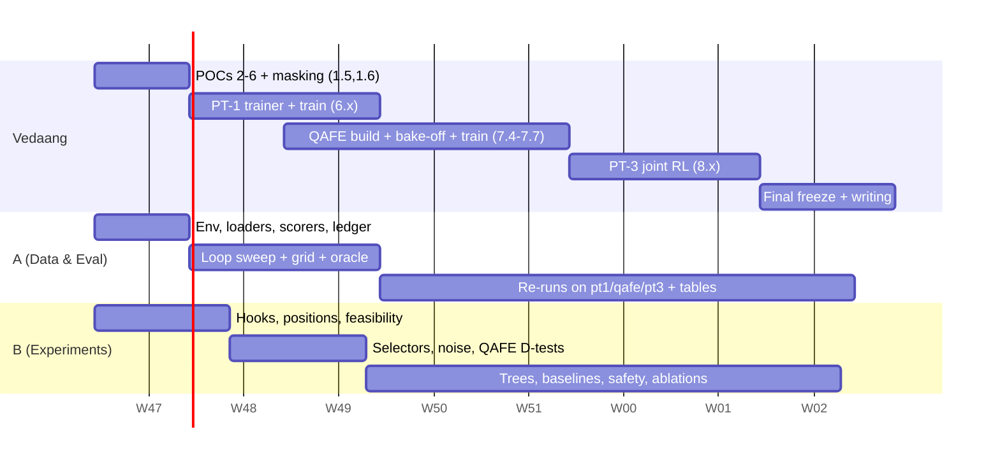

# AdaLoop-VLM — Team Plan (who does what)

v1 · Nov 24, 2026 · owner: Vedaang (lead) · companion to `docs/IMPLEMENTATION.md` (step IDs refer to its §6)

---

## 1. Roles

| Person | Role | Owns | Does not own |
|---|---|---|---|
| **Vedaang (V)** — lead | Research design, all gate decisions, **post-training**, the schedule/masking engine, training infra, paper method + results | PT-1, PT-2 training, PT-3, `core/schedule/`, `core/train/`, `qafe/core/`, `docs/decisions.md`, `configs/prereg.yaml` | Data loaders, scorers, grid runs, baselines, safety sets |
| **`<TEAMMATE_A>` (A)** — Data & Evaluation | Everything that turns items into scored rows | Env, data, splits, prompts, scorers, cost ledger, grid / sweep runs, oracle + stats, final tables + figures | Training code |
| **`<TEAMMATE_B>` (B)** — Experiments & Baselines | Everything that probes the frozen model and every non-trained comparison | Hooks, positions, feasibility suite, selectors, noise test, QAFE decision tests, action trees, baselines, ablation runs, safety | Training code |

**Rule:** V decides; A and B build and run. Any change to a schema, threshold or prompt goes through V.

---

## 2. Principle: V does fast POCs, the team does the full versions

V needs a few answers **early** to start training. V gets them with **quick POCs** (≈ 50 items, notebook-level, rough). A and B later produce the **proper versions** (full items, pipelines, tests, CIs), which go in the paper.

| Question V needs answered | V's POC (week 1) | Proper version (team) |
|---|---|---|
| Can thinking be turned off? | — (A does it day 1; it's quick) | A · 1.1 |
| Does masking equal real pruning? | **POC-2:** 20 items, mask vs compacted | V owns 1.6 permanently |
| Insert vs restart vs drop? | **POC-3:** 50 GQA items, restore-all after pass 2 | B · 2.1–2.5 (G1, G1b) |
| Do gradients flow through a scheduled forward with LoRA, and does it fit in memory? | **POC-4:** 10 items, backward pass | — (V's infra) |
| Does a KL-to-teacher loss go down? | **POC-5:** 50 items, 100 steps | V · 6.4 |
| Does a GRPO loop over actions run and diagnose collapse? | **POC-6:** synthetic trajectory table | V · 8.3 |

---

## 3. Who owns which step

| Step | What | Owner | Hands to |
|---|---|---|---|
| **Phase 0** | | | |
| 0.1 | Environment pins | A | all |
| 0.2 | Package skeleton, `utils/` | A | all |
| 0.3 | Port notebook code; organize notebooks | A | all |
| 0.4 | `prereg.yaml`, `decisions.md` | **V** | all |
| **Phase 1** | | | |
| 1.1 | Thinking off | A (**day 1**) | V, B |
| 1.2 | Original positions + `docs/notes/modeling_code.md` | B | V |
| 1.3 | Loop control test | A | — |
| 1.4 | Per-pass hooks | B | V, B |
| 1.5 | Early readout | **V** | B |
| 1.6 | Mask emulation (`run_scheduled`) + tests | **V** | B (all mid-loop runs) |
| 1.7 | Cost ledger | A | all |
| **Phase 2** | | | |
| 2.1–2.4 | Feasibility suite | B | V |
| 2.5 | Write G1 / G1b | **V** | all |
| **Phase 3** | | | |
| 3.1 | Loaders + evidence boxes | A | all |
| 3.2 | Resolution policy | **V** decides, A implements | all |
| 3.3 | Splits | A | all |
| 3.4 | Prompts, extraction, scorers | A | all |
| 3.5 | Sanity + nondeterminism | A | V |
| **Phase 4** | | | |
| 4.1 | Loop sweep | A | V |
| 4.2 | Selector bake-off (incl. CRISP) | B | V, A |
| 4.3 | Grid + features | A | B, V |
| 4.4 | Oracle + noise ceiling → G2 | A runs, **V** decides | all |
| 4.5 | Evidence retention | A | V |
| 4.6 | Noise test (D3) | B | V |
| 4.7 | Thinking study | A | V |
| **Phase 5** | | | |
| 5.1 | Action trees + outcome-variance statistic | B | V |
| 5.2 | Heuristic controller | B | — |
| 5.3 | Learned controller | **V** (objectives); B runs sweeps | — |
| 5.4 | Baselines | B | A |
| 5.5 | Dev curves | A | V |
| **Phase 6 (PT-1)** | | | |
| 6.1–6.5 | Teacher cache, schedules, LoRA, train, P1 | **V** | — |
| 6.6 | Re-run grid / trees / baselines on `pt1` | A (grid), B (trees, baselines) | V |
| **Phase 7 (PT-2)** | | | |
| 7.1 | D1, D2, D4 decision tests | B | V |
| 7.2 | Gate Q1 | **V** | all |
| 7.3 | Qwen3-VL host adapter | B | V |
| 7.4 | QAFE modules | **V** (core), B (host / tests) | — |
| 7.5–7.6 | Bake-off, full training | **V** trains; A evaluates | — |
| 7.6 | Encoder baselines | B | A |
| 7.7 | upgrade / zoom loop actions | **V** | B |
| **Phase 8 (PT-3)** | | | |
| 8.1–8.5 | Joint RL | **V** | — |
| 8.4 | RL diagnostics dashboard | A | V |
| **Phase 9 (safety)** | | | |
| 9.1–9.4 | Sets, Inspect tasks, measurement | B | V |
| 9.5 | Safety term in the reward | **V** | — |
| **Phase 10** | | | |
| 10.1 | Freeze + tag | **V** | all |
| 10.2 | Main table runs + stats | A | V |
| 10.3 | Ablation runs | B (loop / safety / encoder baselines), V (T1–T4 training ablations) | A |
| 10.4 | Figures | A | V |
| 10.5 | Measured latency | B | A |
| 10.6 | Release | A | — |
| **Phase 11** | | | |
| 11.x | Writing | **V** (method, results, intro); A (experimental setup); B (related work draft, safety section) | V edits all |

---

## 4. Code ownership (to avoid merge fights)

| Path | Owner | Others may |
|---|---|---|
| `adaloop/schemas/`, `configs/prompts.yaml`, `configs/splits/` | A | read only; changes via V |
| `adaloop/data/`, `core/eval/`, `core/cost/`, `orchestration/grid.py`, `orchestration/final_eval.py`, `utils/` | A | open a PR |
| `core/model/hooks.py`, `core/tokens/`, `core/controller/` (except `policy.py` objectives), `core/safety/`, `orchestration/feasibility.py`, `orchestration/tree.py`, `orchestration/ablations.py`, `qafe/hosts/` | B | open a PR |
| `core/schedule/`, `core/model/` (except hooks), `core/train/`, `core/actions/`, `core/controller/policy.py`, `qafe/core/`, `qafe/orchestration/train_*`, `orchestration/train_*` | **V** | open a PR |
| `docs/IMPLEMENTATION.md`, `docs/decisions.md`, `configs/prereg.yaml` | **V** | suggest in a PR |

- Branches: `a/<step-id>`, `b/<step-id>`, `v/<step-id>` → PR into `main`; V reviews schema and config changes, peers review the rest.
- One step = one PR = one ticked box in `IMPLEMENTATION.md`.

---

## 5. Handoff contracts (what each person delivers, in what format)

| From → To | Deliverable | Format | Needed by |
|---|---|---|---|
| A → all | Working env + loaders + scorers | `adaloop.api.load()`, `data.load_items(bench, split)`, `eval.score(item, pred)` | end of week 1 |
| A → V | Thinking-off prompt | `configs/prompts.yaml` + `decisions.md` entry | **day 1** |
| B → V | Modeling-code notes (positions, masks, `final_input`, `message_input`) | `docs/notes/modeling_code.md` | day 2 |
| V → B | `run_scheduled` + tests | `adaloop.api.run_scheduled(item, schedule)` | end of week 1 |
| B → V | G1 / G1b numbers + restore curve | `execution_results/feasibility/*.parquet` | week 2 |
| A → V | Best-R table per benchmark | `runs.parquet` (4.1) | week 2 |
| B → V | Frozen selector | `core/tokens/selectors.py` + dev table | week 2 |
| A → V | Grid + oracle + noise ceiling | `runs.parquet`, `headroom.md` | week 3 |
| B → V | Trees + features + **outcome-variance statistic** | `trajectories.parquet`, `features/` | week 3 |
| B → V | Noise test + D1 / D2 / D4 | `qafe_runs.parquet`, probe parquet | week 3 |
| V → A, B | PT-1 checkpoint | `execution_results/ckpt/pt1/` + `model_variant=pt1` | week 4 |
| V → A, B | QAFE checkpoint | `execution_results/ckpt/qafe/` | week 6 |
| V → A, B | PT-3 policy + LoRA | `execution_results/ckpt/pt3/` | week 7 |

---

## 6. Timeline (relative weeks; adjust after G1)

| Week | V | A | B |
|---|---|---|---|
| 1 | POCs 2–6; 1.5, 1.6 | 0.1–0.3, 1.1 (day 1), 1.3, 1.7, 3.1–3.4 | 1.2, 1.4, notes; start 2.x on V's POC code |
| 2 | 6.1–6.4 (PT-1 trainer on real schedules); decide G1 | 3.5, 4.1 | 2.1–2.4 proper; 4.2 |
| 3 | PT-1 training; decide G2 | 4.3–4.5 | 4.6, 5.1, 7.1 |
| 4 | 6.5 → P1; QAFE modules | 6.6 grid on pt1 | 5.2–5.4; 6.6 trees on pt1 |
| 5–6 | QAFE bake-off → full training | QAFE eval | encoder baselines, Qwen3-VL host, 9.1–9.3 |
| 7 | PT-3 joint RL | RL dashboard; re-runs | 9.4; ablation runs |
| 8 | Freeze, decide G3, write | 10.2, 10.4 | 10.3, 10.5 |

---

## 7. Decision calendar (V decides; inputs come from A and B)

| Decision | Input from | Changes |
|---|---|---|
| Thinking mode | A · 1.1 | all cost numbers, rollout budget |
| G1 insert / restart / drop | B · 2.3 | PT-1 size; look action in Phase 5 |
| Teacher R | A · 4.1 | PT-1 / PT-2 teacher |
| G2 headroom | A · 4.4 | Frozen controller = result or exploratory; re-check on `pt1` |
| RL viability | B · 5.1 outcome variance | PT-3 = GRPO, or full-information with RL as ablation |
| Q1 encoder | B · 7.1 | PT-2 scope; PT-3 includes the router or not |
| PT-2 objective | B · 4.6 noise test | distillation vs outcome term |
| C4 safety | B · 9.4 | μ > 0 in the reward |

---

## 8. Weekly rhythm

- **Mon:** 30 min sync. Each person: done / blocked / next. V updates `decisions.md`.
- **Daily:** async one-liner in the team channel: step ID + status.
- **Fri:** each person merges their steps; A refreshes the results dashboard.

---

## 9. Agent prompts per person

**A — Data & Evaluation**
> You are the agent for `<TEAMMATE_A>` on AdaLoop-VLM. Read `docs/IMPLEMENTATION.md`, `docs/TEAM_PLAN.md`, `AGENTS.md`, `docs/ai_context/CODEBASE_MAP.md`. You work only on steps owned by **A** in TEAM_PLAN §3 and only in paths A owns (§4). Start with Step 0.1, then 1.1 (deadline day 1). One step at a time: layer plan first, wait for approval, then code + tests + exact GPU-host commands. Never touch the `test` split, schemas or prompts without the lead's approval. Branch `a/<step-id>`, PR to `main`.

**B — Experiments & Baselines**
> You are the agent for `<TEAMMATE_B>` on AdaLoop-VLM. Read `docs/IMPLEMENTATION.md`, `docs/TEAM_PLAN.md`, `AGENTS.md`, `docs/ai_context/CODEBASE_MAP.md`. You work only on steps owned by **B** in TEAM_PLAN §3 and only in paths B owns (§4). Start with Step 1.2 (read the Inkling2Loop modeling code; write `docs/notes/modeling_code.md`), then 1.4. Mid-loop experiments use `adaloop.api.run_scheduled` from the lead; do not build your own masking. One step at a time: layer plan first, wait for approval. Branch `b/<step-id>`, PR to `main`.

**V — Lead / post-training**
> You are the agent for the lead on AdaLoop-VLM. Read `docs/IMPLEMENTATION.md`, `docs/TEAM_PLAN.md`, `AGENTS.md`. You work on steps owned by **V** in TEAM_PLAN §3. Start with POC-2 (mask ≡ prune, 20 items) and Step 1.5–1.6. Leave CORE (Vedaang) items as typed signatures + docstrings + `TODO(vedaang)` + failing tests. Then POC-4 (backward through a scheduled forward with LoRA) and POC-5 (KL to teacher on 50 items). Branch `v/<step-id>`.
