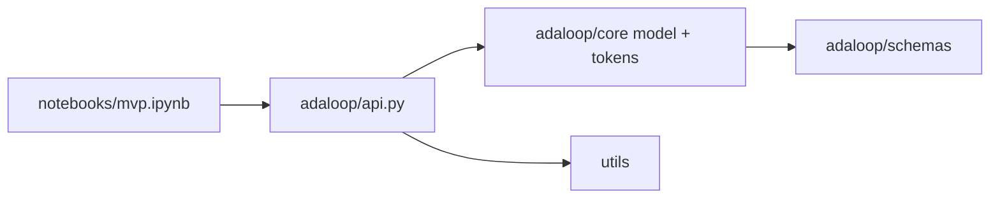

# Codebase map

Kept current by the agent after every step (see `docs/IMPLEMENTATION.md` §0). Lists public entry points and who owns each module.

| Module | Layer | Public entry points | Owner | Status |
|---|---|---|---|---|
| `adaloop/api.py` | L2 | see `adaloop/README.md` | A | model + pruning created |
| `qafe/api.py` | L2 | — | A | not created |
| `utils/` | L5 | `load_config`, `load_image` | A | created |

Notebooks (inspection only): `notebooks/01_huggingfaceload.ipynb`, `notebooks/02_pruning.ipynb`. Loading, inference, loop control and pruning come from `adaloop.api`.
Test notebook: `notebooks/mvp.ipynb`.

