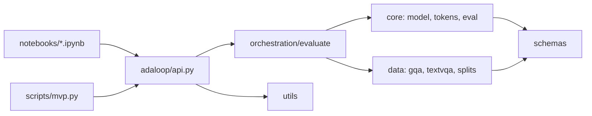

# Codebase map

Kept current by the agent after every step (see `docs/IMPLEMENTATION.md` §0). Lists public entry points and who owns each module.

| Module | Layer | Public entry points | Owner | Status |
|---|---|---|---|---|
| `adaloop/api.py` | L2 | see `adaloop/README.md` | A | model, pruning, GQA + TextVQA data, scoring, evaluation, answer prefill (S2) |
| `adaloop/orchestration/evaluate.py` | L3 | `evaluate_item`, `run_evaluation`, `read_results` | A | created (merged from Jiaqi's repo) |
| `adaloop/core/eval/` | L4 | `extract_answer`, `score`, `score_gqa`, `score_textvqa`, `summarize_rows` | A | GQA, TextVQA |
| `adaloop/data/` | L4 | `load_gqa`, `build_gqa_splits`, `load_textvqa`, `build_textvqa_splits`, `make_splits`, `load_manifest` | A | GQA, TextVQA |
| `adaloop/schemas/` | L5 | `Item`, `LoadedVLM`, `GenerationResult` | A | created |
| `qafe/api.py` | L2 | — | A | not created |
| `utils/` | L5 | `setup_notebook`, `load_config`, `load_image`, `resize_long_side`, `config_hash`, `git_hash`, timing helpers | A | created |
| `scripts/mvp.py` | CLI | `smoke`, `splits`, `eval` | A | created |

Notebooks (they are the tests, see `AGENTS.md`): `01_huggingfaceload` (load, loops), `02_pruning` (visual tokens, selectors), `03_data_and_scoring` (S1 splits, items, scoring, evaluation runner), `04_thinking_off` (S2 answer prefill, `res_px`).
Split manifests: `configs/splits/mvp_<benchmark>.json` (frozen, hashed). Run outputs: `execution_results/mvp/`.

Runs happen on Inara in the `learning_env` kernel (repo at `/coc/scratch/vchopra/cerberus_v2`, branch `main`).

