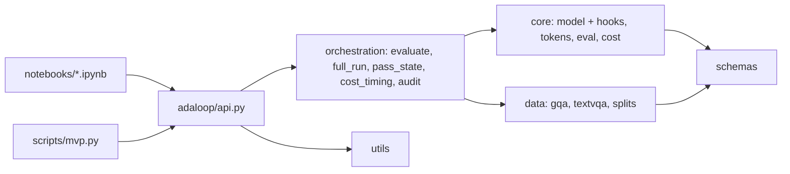

# Codebase map

Kept current by the agent after every step (see `docs/IMPLEMENTATION.md` §0). Lists public entry points and who owns each module.

| Module | Layer | Public entry points | Owner | Status |
|---|---|---|---|---|
| `adaloop/api.py` | L2 | see `adaloop/README.md` | A | model, pruning, GQA + TextVQA data, scoring, evaluation, answer prefill (S2), pass states (S3b) |
| `adaloop/orchestration/full_run.py` | L3 | `shard_items`, `full_run_config`, `result_path`, `run_full`, `summarize_full` | A | created; shards `items[i::n]`, one JSONL per shard and R; test split and `k_grid` != [1.0] refused |
| `adaloop/core/cost/flops.py` | L4 | `cost_params`, `flops_prefill`, `flops_partial`, `flops_readout`, `flops_decode`, `flops_vit`, `flops_total`, `cost_ref` | A | S6; checked on a meta-device model only, notebook 06 step 4 not yet run |
| `adaloop/core/plots/` | L4 | `set_paper_style`, `METHOD_COLORS`, `save_figure`, `save_table` (exposed via `api.py`) | A | paper style, method colours, figure/table output (drafts `execution_results/`, finals `paper/`); `plot_*` for F02-F05 (one file per figure) |
| `utils/paths.py` | L5 | `find_repo_root` | A | nearest folder above this file with `pyproject.toml` (`utils/env.py` has its own cwd-first finder) |
| `adaloop/orchestration/cost_timing.py` | L3 | `time_prefill`, `time_throughput` | A | S6; not yet run on the GPU host |
| `adaloop/orchestration/evaluate.py` | L3 | `item_prompt`, `item_inputs`, `evaluate_item`, `run_evaluation` (`batch_size`), `read_results` | A | created (merged from Jiaqi's repo); batched accuracy runs not yet checked on real weights |
| `adaloop/core/model/inference.py` | L4 | `generate`, `generate_batch`, `last_logits` | A | batch 1 is the reference; left-padded batch added |
| `adaloop/core/model/hooks.py` | L4 | `record_pass_states` | B | last core layer state per pass |
| `adaloop/orchestration/audit.py` | L3 | `wrong_predictions` | B | re-scores saved rows; used by notebook 03 |
| `adaloop/orchestration/pass_state.py` | L3 | `check_pass_state` | B | S3b check |
| `adaloop/core/eval/` | L4 | `extract_answer`, `score`, `score_gqa`, `score_textvqa`, `summarize_rows` | A | GQA, TextVQA |
| `adaloop/data/` | L4 | `load_gqa`, `build_gqa_splits`, `load_textvqa`, `build_textvqa_splits`, `make_splits`, `load_manifest` | A | GQA, TextVQA |
| `adaloop/schemas/` | L5 | `Item`, `LoadedVLM`, `GenerationResult`, `CostParams` | A | created |
| `qafe/api.py` | L2 | — | A | not created |
| `utils/` | L5 | `setup_notebook`, `load_config`, `load_image`, `resize_long_side`, `config_hash`, `git_hash`, timing helpers | A | created |
| `scripts/mvp.py` | CLI | `smoke`, `splits`, `eval`, `full --shard i/n` | A | created; `full` sets CUDA_VISIBLE_DEVICES to `gpu_groups[i]` |
| `utils/hashing.py` | L5 | `config_hash` (drops `HASH_EXCLUDE` = `gpu_groups`), `git_hash` | A | placement is not hashed |

Notebooks (they are the tests, see `AGENTS.md`): `01_huggingfaceload` (load, loops), `02_pruning` (visual tokens, selectors), `03_data_and_scoring` (S1 splits, items, scoring, evaluation runner), `04_thinking_off` (S2 answer prefill, `res_px`), `05_positions_and_loops` (S3 positions, S3b loop control and pass state), `06_full_baseline` (batch check, full run shards, summary, S6 cost model).
Modeling-code findings: `docs/notes/modeling_code.md` (pruning stays packed).
Split manifests: `configs/splits/mvp_<benchmark>.json` (frozen, hashed). Run outputs: `execution_results/mvp/`.

Runs happen on Inara in the `learning_env` kernel (repo at `/coc/scratch/vchopra/cerberus_v2`, branch `main`).

