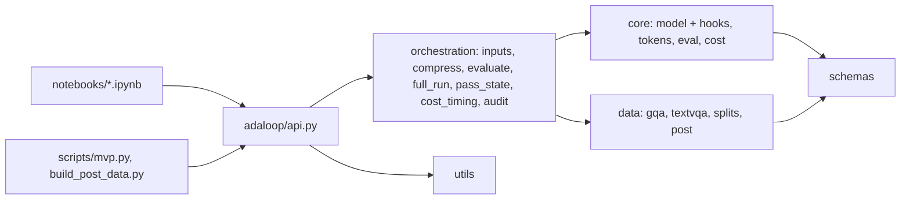

# Codebase map

Kept current by the agent after every step (see `docs/IMPLEMENTATION.md` §0). Lists public entry points and who owns each module.

| Module | Layer | Public entry points | Owner | Status |
|---|---|---|---|---|
| `adaloop/api.py` | L2 | see `adaloop/README.md` | A | model, pruning, GQA + TextVQA data, scoring, evaluation, answer prefill (S2), pass states (S3b) |
| `adaloop/orchestration/full_run.py` | L3 | `shard_items`, `full_run_config`, `result_path`, `run_full` (`vlms`), `estimate_full_run`, `summarize_full` | A | created; shards `items[i::n]`, one JSONL per shard and R; test split and `k_grid` != [1.0] refused |
| `adaloop/orchestration/compress.py` | L3 | `compress`, `METHODS` | A | S4: one interface for all compression methods; checked on a tiny random model, nb07 not yet run on real weights |
| `adaloop/orchestration/inputs.py` | L3 | `item_prompt`, `item_inputs` | A | moved out of `evaluate.py` (compression builds inputs too) |
| `adaloop/core/tokens/` | L4 | `extract_visual_tokens`, `prune_inputs`, selectors, `n_keep_for`; `methods/` (crisp_lite, rediprune, divprune, visionzip, cls_iqr), `vision.py` (attention inputs, then CLS attention and keys per unit) | A | see `docs/notes/compression_baselines.md` |
| `adaloop/orchestration/teacher_cache.py` | L3 | `teacher_items`, `build_teacher_cache`, `teacher_records`, `check_teacher_live`, `teacher_summary` | A | S8; tiny-model check only, nb09 not yet run |
| `adaloop/core/train/` | L4 | `answer_log_probs`, `split_top`, `target_tensors` (`teacher.py`); `read_index`, `write_part`, `load_records` (`teacher_store.py`) | A | S8 teacher store; the S9 files are listed below |
| `adaloop/schemas/train.py` | L5 | `TeacherTarget`, `TrainSample` | A | S9 data contracts; CPU-checked only |
| `adaloop/core/train/schedule.py` | L4 | `parse_teacher_rule`, `teacher_depth`, `variant_name`, `variant_config`, `sample_budget`, `train_sample`, `pairing_table` | A | S9 sample schedule and teacher rule (`lora.teacher_R`); CPU-checked |
| `adaloop/core/train/lora.py` | L4 | `attach_lora`, `load_lora`, `save_lora`, `remove_lora`, `lora_target_names`, `expected_target_count`, `lora_parameters` | A | S9 PEFT attach (peft imported lazily); CPU-checked on a tiny model |
| `adaloop/core/train/distill.py` | L4 | `kl_topk`, `distill_loss`, `training_mode` | A | S9 forward KL on teacher top-32 + tail; not run on GPU |
| `adaloop/orchestration/lora_data.py` | L3 | `load_targets`, `student_inputs`, `item_loss`, `schedule_table` | A | S9 teacher records to student samples; not run on GPU |
| `adaloop/orchestration/train_lora.py` | L3 | `train_lora`, `lora_run_dir`, `lora_run_estimate` | A | S9 training loop, resumable; not run on GPU |
| `adaloop/orchestration/lora_checks.py` | L3 | `one_step_check`, `lora_grad_norms`, `student_layer_calls`, `probe_loss`, `lora_eval_probe` | A | S9 checks and probes (nb10); not run on GPU |
| `adaloop/orchestration/grid.py` | L3 | `grid_items`, `rerun_items`, `run_grid`, `merge_grid` | A | S7; `full_run.py` stays the k = 1 batched baseline; tiny-model check only |
| `adaloop/orchestration/analysis.py` (with `core/eval/oracle.py`, `core/controller/baselines.py`, `core/plots/grid_surface.py`, `core/plots/headroom.py`) | L3 | `load_grid`, `cell_table`, `noise_rate`, `headroom_table`; `plot_kr_accuracy` (F07), `plot_cell_pareto` (F08), `plot_headroom` (F09) | A | analysis of the saved grid (nb08 steps 5-7), config `headroom` (not hashed), refuses test; synthetic grids only |
| `adaloop/orchestration/cells.py` | L3 | `ChunkInputs`, `generate_cell`, `map_copies`, `check_batched` | A | batched compressed evaluation shared by S5/S7; batched = batch 1 not yet checked on real weights |
| `adaloop/orchestration/batching.py` | L3 | `item_chunks`, `batchable_items` | A | equal-length batches; not yet checked on real weights |
| `adaloop/orchestration/batch_diagnostic.py` | L3 | `diagnose_batch` | A | batch 1 vs copies vs mixed batch: logit margins and diffs; nb07 flag `RUN_BATCH_DIAG` |
| `adaloop/orchestration/compare.py` | L3 | `comparison_cells`, `run_comparison`, `comparison_table`, `pick_winner` | A | S5; tiny-model check only, nb07 step 6 not yet run |
| `adaloop/orchestration/resolution.py` | L3 | `run_resolution`, `resolution_table`, `resolution_gain` (plot `core/plots/resolution.py`) | A | resolution check (nb04 step 5), reuses the S5 512 px rows; tiny-model check only |
| `adaloop/core/eval/bootstrap.py`, `core/eval/pareto.py`, `core/plots/compression.py` | L4 | `paired_bootstrap_ci`, `pareto_front`, `plot_pareto` (F06) | A | |
| `adaloop/orchestration/cell_runs.py` | L3 | `run_batch1_cells`, `cell_lines` | A | batch-1 resumable cells with S5 reuse; used by the resolution check and the Pareto sweep |
| `adaloop/orchestration/pareto.py` | L3 | `pareto_cells`, `pareto_reused_cells`, `run_pareto`, `pareto_table` | A | S5b (nb07 step 7), config `pareto` (not hashed); tiny-model check only |
| `adaloop/orchestration/profile.py`, `token_scan.py`, `torch_trace.py` (with `core/model/stage_hooks.py`, `core/plots/token_scan.py`) | L3 | `profile_item`, `profile_items`, `profile_table`, `run_token_scan`, `token_scan_table`, `trace_item`, `record_stages`, `plot_token_scan` (F04b) | A | profiling (nb06 step 7), config `profile` (not hashed), timing only; tiny-model CPU check only |
| `adaloop/orchestration/features.py` | L3 | `run_item_cells`, `save_features`, `load_features` | A | S4b: rows + controller features per (k, R); tiny-model check only; S7 grid builds on it |
| `adaloop/core/controller/features.py` | L4 | `pass_features` | A | `h_last`, `delta_norm`, `vis_attn_mass`, `entropy`, `kl_prev`, `top1_prob` |
| `adaloop/orchestration/tree.py` (with `core/controller/tree.py`, `core/cost/meta.py`, `schemas/runs.py`) | L3 | `load_controller_inputs`, `build_tree`, `run_tree`, `item_tree`, `cost_params_from_config`, `check_test_allowed` | A | S11 trajectory trees; synthetic grid only (`tests/adaloop/test_tree.py`) |
| `adaloop/orchestration/controller.py` (with `core/controller/inputs.py`, `objectives.py`, `policy.py`, `heuristic.py`, `rows.py`; `configs/controller.yaml`) | L3 | `run_policies`, `run_controller`, `run_heuristic`, `train_policy`, `policy_rows`, `select_on_dev` | A; objectives reviewed by V | S12; synthetic grid on CPU only, `tests/adaloop/test_objectives.py` |
| `adaloop/orchestration/baselines.py`, `cell_policies.py`, `choosers.py`, `upfront.py` (with `core/controller/chooser.py`) | L3 | `best_fixed_rows`, `best_fixed_cell_rows`, `oracle_rows`, `early_exit_rows`, `no_h_rows`, `tokens_only_rows`, `upfront_15way_rows`, `random_rows`, `save_baseline_rows`, `run_upfront`, `load_upfront` | A | S13; synthetic grid and tiny model on CPU only (`tests/adaloop/test_baselines.py`) |
| `adaloop/orchestration/headline.py`, `headroom_gate.py` (with `core/controller/curves.py`, `core/plots/iso_cost.py`), `synthetic_run.py` (with `core/controller/synthetic.py`) | L3 | `run_headline`, `headroom_gate`, `plot_iso_cost` (F10), `write_synthetic_grid` | A | S14 (nb11); synthetic grid only, nb11 not yet run on the real grid |
| `adaloop/core/cost/compression.py` | L4 | `compression_flops` | A | analytic cost of the compression step |
| `adaloop/core/cost/flops.py` | L4 | `cost_params`, `flops_prefill`, `flops_partial`, `flops_readout`, `flops_decode`, `flops_vit`, `flops_total`, `row_flops`, `kv_cache_bytes`, `cost_ref` | A | S6; checked on a meta-device model only, notebook 06 step 4 not yet run |
| `adaloop/core/plots/` | L4 | `set_paper_style`, `METHOD_COLORS`, `save_figure`, `save_table` (exposed via `api.py`) | A | paper style, method colours, figure/table output (drafts `execution_results/`, finals `paper/`); `plot_*` for F02-F05 (one file per figure) |
| `utils/paths.py` | L5 | `find_repo_root` | A | nearest folder above this file with `pyproject.toml` (`utils/env.py` has its own cwd-first finder) |
| `adaloop/orchestration/cost_timing.py` | L3 | `time_prefill`, `time_throughput`, `cost_grid`, `time_grid`, `estimate_grid_hours` | A | S6; the grid functions are checked on a tiny model only |
| `adaloop/orchestration/evaluate.py` | L3 | `read_answer`, `evaluate_item`, `run_evaluation` (`batch_size`, `vlms`), `run_chunks`, `read_results` | A | created (merged from Jiaqi's repo); batched accuracy runs not yet checked on real weights; multi-copy threads not yet run on the GPU host |
| `adaloop/orchestration/copies.py` | L3 | `time_copies`, `compare_copies` | A | 1 copy vs all copies: s/item and same outputs; not yet run on the GPU host |
| `adaloop/core/model/load.py` | L4 | `load_model`, `load_models`, `unload_model` | A | copy j on the j-th gpu group, cached per placement; multi-copy not yet run on the GPU host |
| `adaloop/core/model/inference.py` | L4 | `generate`, `generate_batch`, `last_logits` | A | batch 1 is the reference; left-padded batch added |
| `adaloop/core/model/budget.py`, `stopping.py` | L4 | `generate_answers`, `StopOpenThinking` | A | thinking budget with budget forcing; phase 2 re-prefills; not yet run on real weights |
| `adaloop/core/model/hooks.py` | L4 | `record_pass_states`, `record_attention_mass`, `record_first_logits` | B | per pass: last core layer state and attention on visual tokens; first-token logits |
| `adaloop/orchestration/audit.py` | L3 | `wrong_predictions` | B | re-scores saved rows; used by notebook 03 |
| `adaloop/orchestration/pass_state.py` | L3 | `check_pass_state` | B | S3b check |
| `adaloop/core/eval/` | L4 | `extract_answer`, `has_answer_format`, `count_message_tokens`, `score`, `score_lmms`, `score_gqa`, `score_gqa_lmms`, `score_textvqa`, `summarize_rows` | A | GQA, TextVQA |
| `adaloop/data/` | L4 | `load_gqa`, `build_gqa_splits`, `load_textvqa`, `build_textvqa_splits`, `make_splits`, `load_manifest` | A | GQA, TextVQA; `lazy=True` gives `LazyItem` (image decoded per read) |
| `adaloop/schemas/` | L5 | `Item`, `LoadedVLM`, `GenerationResult`, `CostParams` | A | created |
| `qafe/api.py` | L2 | — | A | not created |
| `utils/gpus.py` | L5 | `select_gpu_group`, `claim_gpu_group` (flock per pair, for parallel training), `free_gpu_mib` | A | picks one of `gpu_groups` (or `"all"`, their union) by free memory before CUDA starts; torch-free import chain; notebooks import it from `utils.gpus` before `adaloop.api` (the one exception: GPU choice must precede CUDA init); fix not yet run on the GPU host |
| `utils/` | L5 | `setup_notebook`, `select_gpu_group`, `load_config`, `load_image`, `resize_long_side`, `config_hash`, `git_hash`, timing helpers | A | created; `setup_notebook(config)` only checks `CUDA_VISIBLE_DEVICES` |
| `scripts/mvp.py` | CLI | `smoke`, `splits`, `eval`, `full --shard i/n`, `grid --shard i/n`, `upfront [--limit n]`, `teacher --shard i/n`, `train --variant A\|B [--smoke]` | A | created; `full` uses `select_gpu_group(cfg, group=i)`, `smoke`/`eval` pick a free group; selection runs before `adaloop.api` is imported |
| `utils/hashing.py` | L5 | `config_hash` (drops `HASH_EXCLUDE`: placement, batching and check-only blocks such as `profile`), `git_hash` | A | placement is not hashed |
| `adaloop/orchestration/post_data.py` (with `post_read.py`, `adaloop/data/post/`: `text`, `images`, `eval_hashes`, `sources`, `store`, `run`; `schemas/post_data.py`) | L3 | `build_post_data`, `post_data_dir`, `post_data_eval_hashes`, `load_post_data`, `near_eval`, `phash`, `dhash`; CLI `scripts/build_post_data.py` | A | post-training candidate store (data only, config `post_training_data.yaml`); checked on local parquet fixtures and a few Hub rows, full build not yet run |

Notebooks (they are the tests, see `AGENTS.md`): `01_huggingfaceload` (load, loops), `02_pruning` (visual tokens, selectors), `03_data_and_scoring` (S1 splits, items, scoring, evaluation runner), `04_thinking_off` (S2 answer prefill, `res_px`), `05_positions_and_loops` (S3 positions, S3b loop control and pass state), `06_full_baseline` (batch check, full run shards, summary, S6 cost model), `07_compression` (S4 methods, S4b features, S5 comparison), `08_grid` (S7 grid), `09_teacher_cache` (S8), `11_controller` (S11-S14, CPU only), `12_post_training_data` (candidate store checks).
Modeling-code findings: `docs/notes/modeling_code.md` (pruning stays packed).
Split manifests: `configs/splits/mvp_<benchmark>.json` (frozen, hashed). Run outputs: `execution_results/mvp/`.

Runs happen on Inara in the `learning_env` kernel (repo at `/coc/scratch/vchopra/cerberus_v2`, branch `main`).

