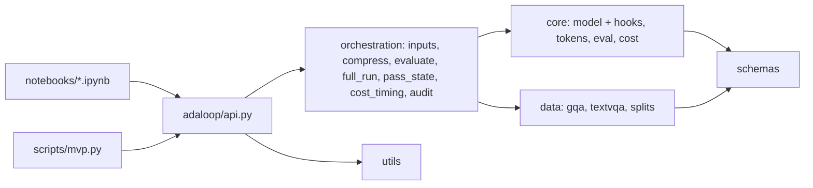

# Codebase map

Kept current by the agent after every step (see `docs/IMPLEMENTATION.md` §0). Lists public entry points and who owns each module.

| Module | Layer | Public entry points | Owner | Status |
|---|---|---|---|---|
| `adaloop/api.py` | L2 | see `adaloop/README.md` | A | model, pruning, GQA + TextVQA data, scoring, evaluation, answer prefill (S2), pass states (S3b) |
| `adaloop/orchestration/full_run.py` | L3 | `shard_items`, `full_run_config`, `result_path`, `run_full` (`vlms`), `estimate_full_run`, `summarize_full` | A | created; shards `items[i::n]`, one JSONL per shard and R; test split and `k_grid` != [1.0] refused |
| `adaloop/orchestration/compress.py` | L3 | `compress`, `METHODS` | A | S4: one interface for all compression methods; checked on a tiny random model, nb07 not yet run on real weights |
| `adaloop/orchestration/inputs.py` | L3 | `item_prompt`, `item_inputs` | A | moved out of `evaluate.py` (compression builds inputs too) |
| `adaloop/core/tokens/` | L4 | `extract_visual_tokens`, `prune_inputs`, selectors, `n_keep_for`; `methods/` (crisp_lite, rediprune, divprune, visionzip), `vision.py` (unit features, CLS attention) | A | see `docs/notes/compression_baselines.md` |
| `adaloop/orchestration/compare.py` | L3 | `comparison_cells`, `run_comparison`, `comparison_table`, `pick_winner` | A | S5; tiny-model check only, nb07 step 6 not yet run |
| `adaloop/core/eval/bootstrap.py`, `core/plots/compression.py` | L4 | `paired_bootstrap_ci`, `plot_compression` (F06) | A | |
| `adaloop/orchestration/features.py` | L3 | `run_item_cells`, `save_features`, `load_features` | A | S4b: rows + controller features per (k, R); tiny-model check only; S7 grid builds on it |
| `adaloop/core/controller/features.py` | L4 | `pass_features` | A | `h_last`, `delta_norm`, `vis_attn_mass`, `entropy`, `kl_prev`, `top1_prob` |
| `adaloop/core/cost/compression.py` | L4 | `compression_flops` | A | analytic cost of the compression step |
| `adaloop/core/cost/flops.py` | L4 | `cost_params`, `flops_prefill`, `flops_partial`, `flops_readout`, `flops_decode`, `flops_vit`, `flops_total`, `row_flops`, `cost_ref` | A | S6; checked on a meta-device model only, notebook 06 step 4 not yet run |
| `adaloop/core/plots/` | L4 | `set_paper_style`, `METHOD_COLORS`, `save_figure`, `save_table` (exposed via `api.py`) | A | paper style, method colours, figure/table output (drafts `execution_results/`, finals `paper/`); `plot_*` for F02-F05 (one file per figure) |
| `utils/paths.py` | L5 | `find_repo_root` | A | nearest folder above this file with `pyproject.toml` (`utils/env.py` has its own cwd-first finder) |
| `adaloop/orchestration/cost_timing.py` | L3 | `time_prefill`, `time_throughput`, `cost_grid`, `time_grid`, `estimate_grid_hours` | A | S6; the grid functions are checked on a tiny model only |
| `adaloop/orchestration/evaluate.py` | L3 | `read_answer`, `evaluate_item`, `run_evaluation` (`batch_size`, `vlms`), `run_chunks`, `read_results` | A | created (merged from Jiaqi's repo); batched accuracy runs not yet checked on real weights; multi-copy threads not yet run on the GPU host |
| `adaloop/orchestration/copies.py` | L3 | `time_copies`, `compare_copies` | A | 1 copy vs all copies: s/item and same outputs; not yet run on the GPU host |
| `adaloop/core/model/load.py` | L4 | `load_model`, `load_models`, `unload_model` | A | copy j on the j-th gpu group, cached per placement; multi-copy not yet run on the GPU host |
| `adaloop/core/model/inference.py` | L4 | `generate`, `generate_batch`, `last_logits` | A | batch 1 is the reference; left-padded batch added |
| `adaloop/core/model/budget.py`, `stopping.py` | L4 | `generate_answers`, `StopOpenThinking` | A | thinking budget with budget forcing; phase 2 re-prefills; not yet run on real weights |
| `adaloop/core/model/hooks.py` | L4 | `record_pass_states`, `record_attention_mass`, `record_first_logits` | B | per pass: last core layer state and attention on visual tokens; first-token logits |
| `adaloop/orchestration/audit.py` | L3 | `wrong_predictions` | B | re-scores saved rows; used by notebook 03 |
| `adaloop/orchestration/pass_state.py` | L3 | `check_pass_state` | B | S3b check |
| `adaloop/core/eval/` | L4 | `extract_answer`, `has_answer_format`, `count_message_tokens`, `score`, `score_lmms`, `score_gqa`, `score_gqa_lmms`, `score_textvqa`, `summarize_rows` | A | GQA, TextVQA |
| `adaloop/data/` | L4 | `load_gqa`, `build_gqa_splits`, `load_textvqa`, `build_textvqa_splits`, `make_splits`, `load_manifest` | A | GQA, TextVQA |
| `adaloop/schemas/` | L5 | `Item`, `LoadedVLM`, `GenerationResult`, `CostParams` | A | created |
| `qafe/api.py` | L2 | — | A | not created |
| `utils/gpus.py` | L5 | `select_gpu_group`, `free_gpu_mib` | A | picks one of `gpu_groups` (or `"all"`, their union) by free memory before CUDA starts; torch-free import chain; notebooks import it from `utils.gpus` before `adaloop.api` (the one exception: GPU choice must precede CUDA init); fix not yet run on the GPU host |
| `utils/` | L5 | `setup_notebook`, `select_gpu_group`, `load_config`, `load_image`, `resize_long_side`, `config_hash`, `git_hash`, timing helpers | A | created; `setup_notebook(config)` only checks `CUDA_VISIBLE_DEVICES` |
| `scripts/mvp.py` | CLI | `smoke`, `splits`, `eval`, `full --shard i/n` | A | created; `full` uses `select_gpu_group(cfg, group=i)`, `smoke`/`eval` pick a free group; selection runs before `adaloop.api` is imported |
| `utils/hashing.py` | L5 | `config_hash` (drops `HASH_EXCLUDE` = `gpu_groups`, `min_free_gib`), `git_hash` | A | placement is not hashed |

Notebooks (they are the tests, see `AGENTS.md`): `01_huggingfaceload` (load, loops), `02_pruning` (visual tokens, selectors), `03_data_and_scoring` (S1 splits, items, scoring, evaluation runner), `04_thinking_off` (S2 answer prefill, `res_px`), `05_positions_and_loops` (S3 positions, S3b loop control and pass state), `06_full_baseline` (batch check, full run shards, summary, S6 cost model), `07_compression` (S4 methods).
Modeling-code findings: `docs/notes/modeling_code.md` (pruning stays packed).
Split manifests: `configs/splits/mvp_<benchmark>.json` (frozen, hashed). Run outputs: `execution_results/mvp/`.

Runs happen on Inara in the `learning_env` kernel (repo at `/coc/scratch/vchopra/cerberus_v2`, branch `main`).

