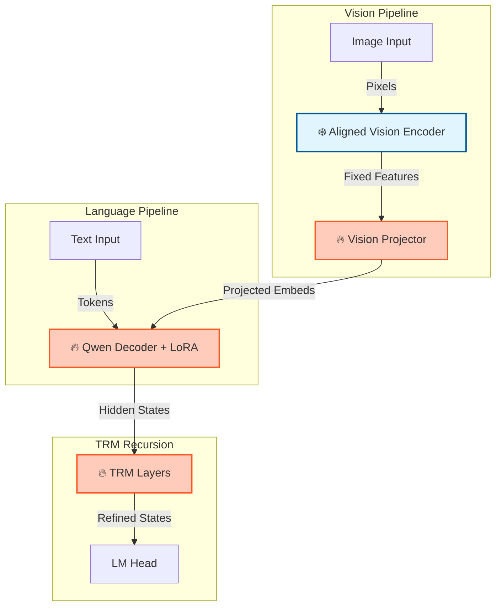

# Edge Glass System Architecture

The following diagram illustrates the two-stage training pipeline for the Edge Glass VLM.

```mermaid
graph TB
    %% Professional IEEE Paper Styles
    classDef frozen fill:#e8e8e8,stroke:#666666,stroke-width:2px,stroke-dasharray: 5 5
    classDef trainable fill:#d6e9f8,stroke:#2e5c8a,stroke-width:2px
    classDef input fill:#ffffff,stroke:#333333,stroke-width:1.5px
    classDef head fill:#f0f0f0,stroke:#555555,stroke-width:2px

    %% Shared input
    I(Image):::input --> VE[CLIP ViT Image Encoder<br/>frozen]:::frozen
    VE --> Patches[Patch tokens<br/>B, T_img, hidden_dim]:::frozen

    %% Perceiver path
    subgraph Perceiver_Path ["use_perceiver = True"]
        direction TB
        LP[Linear adapter<br/>hidden_dim to latent_dim]:::trainable
        PR[Perceiver Resampler<br/>K latents x latent_dim<br/>cross-attn to patches]:::trainable
        FP[Projection<br/>latent_dim to 4096]:::trainable
        PM[Mean pool over K latents<br/>B, 4096]:::trainable
        VN1[L2 Norm]:::trainable
        VM1[MRL Head optional]:::head
        
        LP --> PR --> FP --> PM --> VN1 --> VM1
    end

    %% Non-Perceiver path
    subgraph Non_Perceiver_Path ["use_perceiver = False"]
        direction TB
        LP2[Linear projection<br/>hidden_dim to 4096]:::trainable
        Pool2[Attention Pool or CLS<br/>B, 4096]:::trainable
        VN2[L2 Norm]:::trainable
        VM2[MRL Head optional]:::head
        
        LP2 --> Pool2 --> VN2 --> VM2
    end

    %% Text branch
    T(Text):::input --> TE[CLIP Text Encoder<br/>frozen]:::frozen
    TE --> TP[Text projector<br/>d_txt to 4096]:::trainable
    TP --> TN[L2 Norm]:::trainable
    TN --> TM[MRL Head optional]:::head

    %% Connect paths
    Patches -.-> LP
    Patches -.-> LP2

    %% Alignment / downstream
    VM1 --> Align[Alignment Losses<br/>contrastive + MRL]:::head
    VM2 --> Align
    TM --> Align
    Align --> VLM[Decoder / VLM<br/>e.g., Qwen]:::trainable
```mermaid
%% Shared input
I(Image):::trainable --> VE[CLIP ViT Image Encoder<br/>(frozen)]:::frozen
VE --> Patches[Patch tokens<br/>(B, T_img, hidden_dim)]:::frozen

%% Perceiver path
subgraph Perceiver_Path [use_perceiver = True]
    direction TB
    Patches --> LP[Linear adapter<br/>hidden_dim → latent_dim]:::trainable
    LP --> PR[Perceiver Resampler<br/>(K latents × latent_dim)<br/>cross-attn to patches]:::trainable
    PR --> FP[Projection<br/>latent_dim → 4096]:::trainable
    FP --> PM[Mean pool over K latents<br/>(B, 4096)]:::trainable
    PM --> VN1[L2 Norm]:::trainable
    VN1 --> VM1[MRL Head (optional)]:::head
end

%% Non-Perceiver path
subgraph Non_Perceiver_Path [use_perceiver = False]
    direction TB
    Patches --> LP2[Linear projection<br/>hidden_dim → 4096]:::trainable
    LP2 --> Pool2[Attention Pool or CLS<br/>(B, 4096)]:::trainable
    Pool2 --> VN2[L2 Norm]:::trainable
    VN2 --> VM2[MRL Head (optional)]:::head
end

%% Text branch (unchanged)
T(Text):::trainable --> TE[CLIP Text Encoder<br/>(frozen)]:::frozen
TE --> TP[Text projector<br/>d_txt → 4096]:::trainable
TP --> TN[L2 Norm]:::trainable
TN --> TM[MRL Head (optional)]:::head

%% Alignment / downstream
VM1 --> Align[Alignment Losses<br/>(contrastive + MRL)]:::head
VM2 --> Align
TM --> Align
Align --> VLM[Decoder / VLM (e.g., Qwen)]:::trainable
```mermaid
%% Shared input
I(Image):::trainable --> VE[CLIP ViT Image Encoder<br/>(frozen)]:::frozen
VE --> Patches[Patch tokens<br/>(B, T_img, hidden_dim)]:::frozen

%% Perceiver path
subgraph Perceiver_Path [use_perceiver = True]
    direction TB
    Patches --> LP[Linear adapter<br/>hidden_dim → latent_dim]:::trainable
    LP --> PR[Perceiver Resampler<br/>(K latents × latent_dim)<br/>cross-attn to patches]:::trainable
    PR --> FP[Projection<br/>latent_dim → 4096]:::trainable
    FP --> PM[Mean pool over K latents<br/>(B, 4096)]:::trainable
    PM --> VN1[L2 Norm]:::trainable
    VN1 --> VM1[MRL Head (optional)]:::head
end

%% Non-Perceiver path
subgraph Non_Perceiver_Path [use_perceiver = False]
    direction TB
    Patches --> LP2[Linear projection<br/>hidden_dim → 4096]:::trainable
    LP2 --> Pool2[Attention Pool or CLS<br/>(B, 4096)]:::trainable
    Pool2 --> VN2[L2 Norm]:::trainable
    VN2 --> VM2[MRL Head (optional)]:::head
end

%% Text branch (unchanged)
T(Text):::trainable --> TE[CLIP Text Encoder<br/>(frozen)]:::frozen
TE --> TP[Text projector<br/>d_txt → 4096]:::trainable
TP --> TN[L2 Norm]:::trainable
TN --> TM[MRL Head (optional)]:::head

%% Alignment / downstream
VM1 --> Align[Alignment Losses<br/>(contrastive + MRL)]:::head
VM2 --> Align
TM --> Align
Align --> VLM[Decoder / VLM (e.g., Qwen)]:::trainable
```mermaid
%% Shared input
I(Image):::trainable --> VE[CLIP ViT Image Encoder<br/>(frozen)]:::frozen
VE --> Patches[Patch tokens<br/>(B, T_img, hidden_dim)]:::frozen

%% Perceiver path
subgraph Perceiver_Path [use_perceiver = True]
    direction TB
    Patches --> LP[Linear adapter<br/>hidden_dim → latent_dim]:::trainable
    LP --> PR[Perceiver Resampler<br/>(K latents × latent_dim)<br/>cross-attn to patches]:::trainable
    PR --> FP[Projection<br/>latent_dim → 4096]:::trainable
    FP --> PM[Mean pool over K latents<br/>(B, 4096)]:::trainable
    PM --> VN1[L2 Norm]:::trainable
    VN1 --> VM1[MRL Head (optional)]:::head
end

%% Non-Perceiver path
subgraph Non_Perceiver_Path [use_perceiver = False]
    direction TB
    Patches --> LP2[Linear projection<br/>hidden_dim → 4096]:::trainable
    LP2 --> Pool2[Attention Pool or CLS<br/>(B, 4096)]:::trainable
    Pool2 --> VN2[L2 Norm]:::trainable
    VN2 --> VM2[MRL Head (optional)]:::head
end

%% Text branch (unchanged)
T(Text):::trainable --> TE[CLIP Text Encoder<br/>(frozen)]:::frozen
TE --> TP[Text projector<br/>d_txt → 4096]:::trainable
TP --> TN[L2 Norm]:::trainable
TN --> TM[MRL Head (optional)]:::head

%% Alignment / downstream
VM1 --> Align[Alignment Losses<br/>(contrastive + MRL)]:::head
VM2 --> Align
TM --> Align
Align --> VLM[Decoder / VLM (e.g., Qwen)]:::trainable
```
```mermaid
%% Shared input
I(Image):::trainable --> VE[CLIP ViT Image Encoder<br/>(frozen)]:::frozen
VE --> Patches[Patch tokens<br/>(B, T_img, hidden_dim)]:::frozen

%% Perceiver path
subgraph Perceiver_Path [use_perceiver = True]
    direction TB
    Patches --> LP[Linear adapter<br/>hidden_dim → latent_dim]:::trainable
    LP --> PR[Perceiver Resampler<br/>(K latents × latent_dim)<br/>cross-attn to patches]:::trainable
    PR --> FP[Projection<br/>latent_dim → 4096]:::trainable
    FP --> PM[Mean pool over K latents<br/>(B, 4096)]:::trainable
    PM --> VN1[L2 Norm]:::trainable
    VN1 --> VM1[MRL Head (optional)]:::head
end

%% Non-Perceiver path
subgraph Non_Perceiver_Path [use_perceiver = False]
    direction TB
    Patches --> LP2[Linear projection<br/>hidden_dim → 4096]:::trainable
    LP2 --> Pool2[Attention Pool or CLS<br/>(B, 4096)]:::trainable
    Pool2 --> VN2[L2 Norm]:::trainable
    VN2 --> VM2[MRL Head (optional)]:::head
end

%% Text branch (unchanged)
T(Text):::trainable --> TE[CLIP Text Encoder<br/>(frozen)]:::frozen
TE --> TP[Text projector<br/>d_txt → 4096]:::trainable
TP --> TN[L2 Norm]:::trainable
TN --> TM[MRL Head (optional)]:::head

%% Alignment / downstream
VM1 --> Align[Alignment Losses<br/>(contrastive + MRL)]:::head
VM2 --> Align
TM --> Align
Align --> VLM[Decoder / VLM (e.g., Qwen)]:::trainable
```
```

## Legend

| Visual Style | Component Status | Description |
| :--- | :--- | :--- |
| **Blue / Solid Border** | **Trainable** | Parameters are updated during this training stage. |
| **Grey / Dashed Border** | **Frozen** | Parameters are static (loaded from previous stage or base model). |
| **Orange** | **Loss Module** | Used for optimization objectives (e.g., Contrastive/MRL). |
| **White** | **Input / Output** | Data elements flowing through the system. |


