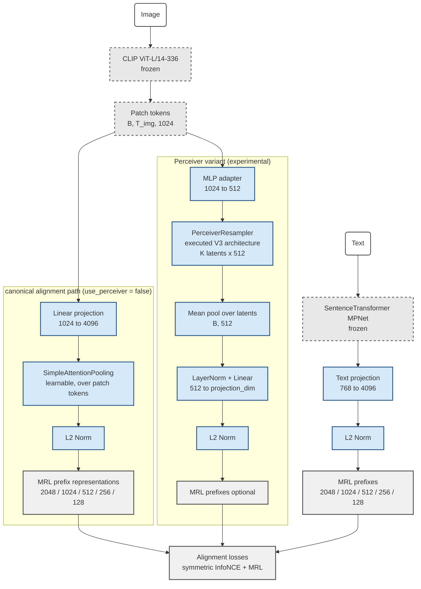
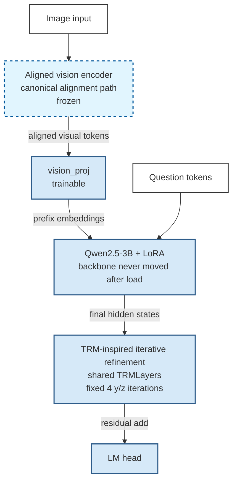
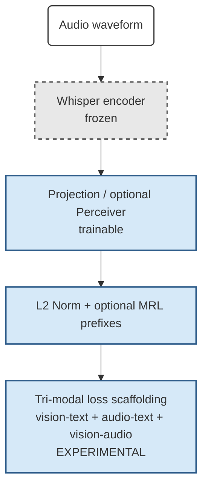

# Edge Glass System Architecture — maintained graph

Current architecture of `edge_glass_modular/`, grouped into the three maintained surfaces:
the **canonical alignment path**, the **VLM / TRM-inspired refinement path**, and the
**retained experimental audio support**. Retired subsystems (fusion, decoder Path C /
`MultimodalProjector`, standalone `TRMDecoder`) are intentionally absent.

Frozen/trainable styling: grey dashed = frozen; blue solid = trainable.

## 1. Canonical alignment path

The **canonical** path (`configs/pixmo_alignment.yaml`, attention pooling, no perceiver) produced the
authoritative retained alignment results in `results/alignment/alignment_eval_final/`.

The **Perceiver variant** (`src/encoders/perceiver.py`) now implements the executed V3-training
architecture. The historical Perceiver metric in the final CSVs is **provenance-compromised**
(historical evaluation architecture differed from training; `strict=False` checkpoint loading) and must
not be read as an architecture verdict; a controlled rerun is required.

## 2. VLM path — Qwen + TRM-inspired iterative refinement

Precisely:

- Refinement reuses a **shared stack of `TRMLayer`s**; the y/z loop runs a **fixed 4 iterations** over
  the Qwen final hidden states, then the refined state is residual-added before the LM head.
- This is **TRM-inspired iterative refinement**, *not* a faithful TinyRecursiveModels implementation
  (no adaptive halting, fixed depth). **No standalone `TRMDecoder` exists anymore.**
- No quantitative VLM improvement is claimed in the retained evidence.

## 3. Retained experimental audio support

Audio is **retained experimental support** (`src/encoders/audio.py`, tri-modal loss in
`src/models/losses.py`). No retained experiment demonstrates successful tri-modal alignment or tri-modal
VLM training; do not infer audio results from the vision-text results. Fusion is retired and not shown.
